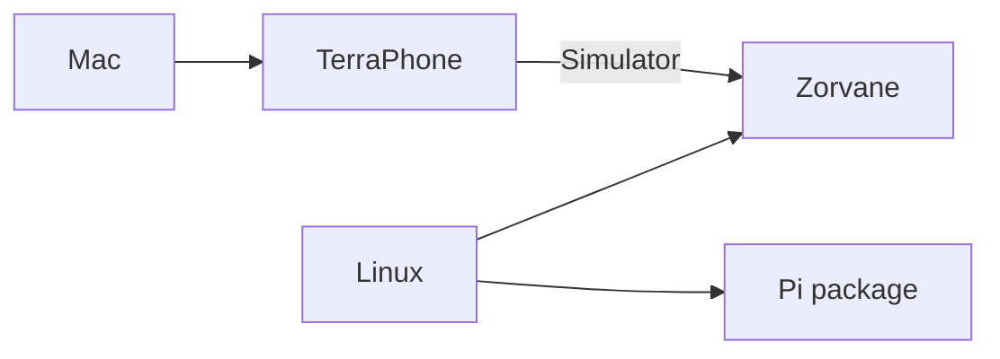

# Develop the world without a Mac

!!! tip "TL;DR"
    Zorvane runs on Linux.
    The Xcode project still needs a Mac.
    xtool can build TerraPhone on Linux after an Xcode `.xip` is installed.
    The Pi image also builds on Linux, with Docker.

*World loop does not need this splash. The app does.*

*From a [Zorvane](https://super-yojan.dev/Zorvane/) checkout: `cargo run -p zorvane`.*

`TERRA_TILES`, `TERRA_ROVER_COUNT`, `TERRA_MISSION`, and `TERRA_ZENOH_LISTEN` still apply. Default listen is `tcp/127.0.0.1:7447`.

Build notes: [Zorvane README](https://github.com/Super-Yojan/Zorvane/blob/main/README.md).

Phone on a Mac: `./scripts/build-ios.sh`, then the Xcode project. See [Xcode](phone/build.md).

Phone on Linux: [xtool](phone/linux.md). `./scripts/build-ios-linux.sh` stops until `xtool sdk install` has unpacked an Xcode `.xip`. That download needs an Apple ID.
