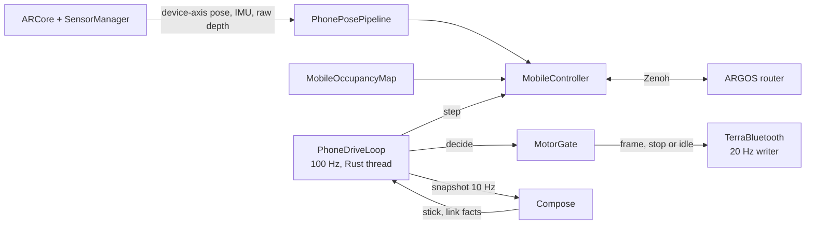

# TerraPhone for Android

> [!TIP]
> **TL;DR**
> Kotlin and Compose shell over `terra-mobile`.
> Rust owns the 100 Hz control tick and decides every motor frame.
> Any target can connect to ARGOS; the emulator also talks to Zorvane at `10.0.2.2`.



*Same crates as the iOS app. Kotlin samples sensors, runs the radio and draws the screen.*

## What you need

- Rust stable, with `aarch64-linux-android` and `x86_64-linux-android`.
- [cargo-ndk](https://github.com/bbqsrc/cargo-ndk) 3.5.4 (`cargo install cargo-ndk --version 3.5.4 --locked`).
- Android SDK platform 35, build-tools 35.0.0, and NDK r27.
- JDK 17 or newer.
- A device or an emulator image. The debug APK ships `arm64-v8a` and `x86_64`.

`ANDROID_NDK_HOME` must point at the NDK directory (the one that contains `source.properties`). `ANDROID_HOME` is enough for Gradle. If `ANDROID_NDK_HOME` is unset and `ANDROID_HOME/ndk/<version>` exists, `scripts/build-android.sh` uses the newest one there.

## Build and run

From the repository root:

```sh
export ANDROID_HOME="$HOME/android-sdk"
export ANDROID_NDK_HOME="$ANDROID_HOME/ndk/27.2.12479018"
./scripts/build-android.sh
cd mobile/android
./gradlew assembleDebug
```

`build-android.sh` builds the host `libterra_mobile.so` (the JVM smoke test loads it), generates the Kotlin bindings, and places release `.so` files in `app/src/main/jniLibs`. Those outputs are gitignored, the same way `mobile/ios/Generated/` is.

UniFFI 0.31 names exception fields `message`. Kotlin 2 rejects that because it clashes with `Throwable.message`. The script renames those generated properties to `errorMessage`. The workspace uniffi pin stays `0.31.1`.

Install `app/build/outputs/apk/debug/app-debug.apk`. On an emulator, start Zorvane on the host so the guest can reach it:

```sh
TERRA_ROVER_COUNT=1 TERRA_ZENOH_LISTEN=tcp/0.0.0.0:7447 cargo run -p zorvane
```

The default endpoint in the emulator UI is `tcp/10.0.2.2:7447`, rover `0`. `10.0.2.2` is the emulator's name for the host. Connect starts at zero. Stop, and leaving the app, close the session with a final zero. The Rust publisher still expires its 250 ms command lease if the UI stops refreshing it.

## Connection surfaces

The check is the emulator fingerprint (`goldfish` / `ranchu` / SDK build), not a settings toggle.

| Target | Zorvane · Zenoh | ARGOS | Bluetooth actuators |
| --- | --- | --- | --- |
| Emulator | Shown. Endpoint and rover ID persist. Connect publishes `cmd_vel` and subscribes to that rover’s depth camera. | Shown. | Hidden. |
| Physical phone | Hidden. Launch deletes any stored endpoint and rover ID. | Shown. | Scan, connect, pair, read capabilities and layout, stage/commit that layout, arm. |

**Simulated rover** is the local motor plant from `SimulatedPlant`. It is on both targets and never drives hardware. **Phone IMU + VIO** needs a physical device with camera permission, a gyroscope, linear acceleration, and ARCore. The emulator reports that phone tracking is unavailable. **Bluetooth drive** runs the controller with no phone sensors; the stick is normalized effort.

## Driving the rover

Phone IMU + VIO and Bluetooth drive both start a `PhoneDriveLoop`. It is a Rust thread that ticks at 100 Hz on the sensor clock. Each tick it applies the phone stick (unless ARGOS owns intent), steps `MobileController`, handles a failed router link, and asks `MotorGate.decide` for a command. The Bluetooth writer takes that command every 50 ms:

| Gate answer | Bluetooth writes |
| --- | --- |
| `Drive` (frame under 150 ms old) | Those actuator values: relay pairs or a `TA` drive frame. |
| `Stop` | Neutral values once. The link stays armed. |
| `Idle` | Nothing, except one neutral write right after a frame. The rover's lease stops it. |

The gate holds motors until **The phone is in its mount** is checked, latches emergency stop until **Reset stop**, stops on tracking loss in tracking-dependent modes, and needs left/right wheel routes for closed-loop drive. The controller's actuator layout is the rover's drive profiles, or the full layout on a framed session. Kotlin no longer mixes the stick itself.

**ARGOS** connects the running controller with `reconnectDashboardAuthenticated` (defaults match iOS: `tls/argos.34.135.204.210.sslip.io:7448`, prefix `terra/phone`, user `terra`). A lost link calls `handle_dashboard_link_loss` in Rust and retries on the `ConnectionPolicy` back-off. Connecting never arms the rover. The password sits in app-private preferences.

**Run logs** go to `files/runs/Terra-run-<id>.jsonl`. **Share run log** hands the current one to another app; leaving the app for the share sheet stops driving.

## Phone mount

Android uses the iOS mount convention through `PhonePosePipeline` with `PoseAxes.DEVICE`. Uncalibrated is upright portrait with the rear camera forward. Terra carries the phone landscape, screen toward the rover, camera 0.23 m up: the two presets set roll −90° (top edge on the rover's left) or +90°. The roll sign has not been checked on the rover. **Start turn pass** / **Finish pass**, once each way, fit the camera offset from the turn centre. The activity follows device rotation without restarting the session.

## Sensor contract

Timestamps are seconds on the sensor clock, `SystemClock.elapsedRealtimeNanos` (what `SensorEvent.timestamp` uses). ARCore leaves its frame time base open and in practice uses `System.nanoTime`, which falls behind by however long the phone has slept since boot; `ar_time_on_sensor_clock` moves frame times onto the sensor clock. Body axes stay X forward, Y left, Z up.

`PhonePosePipeline.imu` turns device-axis IMU (X right, Y toward the top edge, Z out of the screen) into that body frame through the mount. Android linear acceleration is already m/s².

`PhonePosePipeline.push_pose` takes ARCore `Frame.getAndroidSensorPose` (device axes in the Y-up world, unaffected by display rotation) and applies the mount, the camera offset and the velocity filter. Tracking loss pushes `tracked = false`, and the gate and controller command neutral output. A missing or unsupported ARCore install does not invent a pose. Leaving the foreground calls `stop()`, which resets the controller, sends safe actuator output and drops a Bluetooth link, and, on the emulator, disconnects Zenoh.

Phone depth, when ARCore Depth is supported, uses the raw 16-bit image and its confidence image (`acquireRawDepthImage16Bits`, `acquireRawDepthConfidenceImage`). `depth16_to_metres` drops zero depth and confidence under 128/255. Intrinsics are rescaled onto the depth image and the pose goes through `y_up_camera_to_optical_pose` into `MobileOccupancyMap`, which is attached to the controller so the planner and ARGOS see it. The floor is latched the mount's camera height below the phone, or 0.5 m without a plausible calibration. Devices without depth keep velocity control and say so. This phone path has not been run on hardware.

## Waypoint

**Go to waypoint** calls `MobileWaypoint.setOrigin` and `setGoal`. While the goal is latched the sliders stay idle. Each tick steps the follower with the simulated plant pose, the phone body pose, or the Zorvane depth frame’s body pose, and that twist is the command. On Zenoh it is `cmd_vel`. The `goal` topic stays idle during that run, so Zorvane does not latch a second follower. **Cancel waypoint**, Stop, and leaving the app drop the latch. **Johnson Center, 12 m north** fills the same default fields as iOS. The reachable square is 49 m. Map taps use `geographicPosition`.

## Autonomy

The picker uses `supported_autonomy_levels()` for teleop, assisted teleop, waypoint, supervised search and time-bounded exploration. **Explore · 120 seconds** sends an explicit duration to the shared arbiter. Direct waypoint is available in the shared API; target-search capability remains detector-dependent.

Level changes go out as `autonomy` actions. Emergency stop and reset go out as `safety`. Approving or rejecting a search target sends `goal/decision`. On the emulator those are Zenoh puts. Locally they are `MobileController.autonomyRequest`.

## Tests

```sh
cargo test --locked --workspace
./scripts/build-android.sh
cd mobile/android && ./gradlew assembleDebug testDebugUnitTest
python3 scripts/check-zenoh-kotlin.py   # needs the eclipse-zenoh Python package
```

`PhoneDriveSmokeTest` runs a `PhoneDriveLoop` over a full layout until it hands out a drive frame, checks that an unconfirmed mount stops the phone source, checks the device-axis mount convention, and decodes raw depth with confidence. `TerraCoreSmokeTest` constructs `MobileController`, steps a sample, and checks that the right wheel effort is larger and that a one-second gap returns zero. It also calls the shared axis conversion, `MobileWaypoint`, and `runVelocityBenchmark`. The actuator case routes a stick through a layout and a drive profile, checks streamed-relay percent pairs, a 16-byte `TA` disarm frame, fragment reassembly, and a `capabilities` control envelope. With `TERRA_ZENOH_SMOKE_ENDPOINT` set, the same test opens `MobileZenohClient` against a Python peer, checks `terra/rover/9/cmd_vel`, the moving payload, lease expiry to zero, the final zero from `disconnect`, and that one posed depth frame occupies a cell.

## What was verified, and what was not

Verified on Linux, without a phone:

- `cargo test --locked --workspace`.
- `./scripts/build-android.sh` for `aarch64-linux-android` and `x86_64-linux-android`.
- `./gradlew assembleDebug` and `testDebugUnitTest`.
- `scripts/check-zenoh-kotlin.py` against a Python Zenoh peer (topic, payload, lease zero, disconnect zero, depth integration).
- A headless Zorvane process (`TERRA_HEADLESS=1`, `TERRA_ZENOH_LISTEN=tcp/0.0.0.0:7447`) published `terra/rover/0/camera/depth`. A Zenoh client on `tcp/127.0.0.1:7447` received that frame, and a forward `cmd_vel` moved the rover body. The same `MobileZenohClient` the app uses connected from the host JVM, published a reverse target, and the sampled body pose moved backward. Depth delivery on that session was sparse (a handful of frames), so this was not a UI drive and not a measured closed-loop run.

Verified for P1 (Android parity), in a Linux container without the Android SDK:

- `cargo test -p terra-mobile --lib`, including `PhoneDriveLoop`, full-layout frames, raw depth decoding, and the AR clock mapping.
- `TerraCoreSmokeTest` and `PhoneDriveSmokeTest` compiled with `kotlinc` 2.0.21 and run through JNA against the host library.
- The app sources type-checked with `kotlinc` against Robolectric's `android-all` and hand-written stubs for Compose, ARCore and AndroidX. That is not a Gradle build.

Not verified:

- `./gradlew assembleDebug` for P1. Google Maven was unreachable from that container.
- Driving a rover from Android, ARGOS on a phone, the mount presets, raw depth, or rotation on hardware.

- An Android emulator UI session. An API 35 AVD was created and QEMU started with KVM, but the process never created vCPUs and adb stayed offline, so the APK was not installed. No demo was recorded.
- ARCore tracking, raw depth, or the mount presets on hardware.
- Bluetooth on a radio. The physical-phone screen scans for service `7e5a0010-4c2b-4f91-9e3a-1d8c6b2a0f10`, connects, accepts pairing, reads status, subscribes, and exchanges capabilities, layout, stage, and commit. Motion uses Rust. A rover that reports `control_mode: streamed_relay` gets `(id, signed percent)` drive bytes from `actuator_encode_relay_drive` after `actuator_route_profiles`. A status document with a session and no streamed-relay mode gets `TA` frames from `actuator_encode_frame`, including disarm. Arm, Disarm, Stop, emergency stop, and leaving the app send safe output; Stop and leaving the app also disconnect. None of that has been run against a rover or a BlueZ adapter. See [Bluetooth peripheral](hardware/BLUETOOTH.md).
- The iOS app after the Swift call sites moved onto the new UniFFI functions. Rebuild with `./scripts/build-ios.sh` on a Mac before running TerraPhone there. The new actuator functions are additive. Swift still sends a waypoint as an arbiter `goal` rather than stepping `MobileWaypoint` itself. iOS keeps its own streamed-relay encoder until that app calls the new exports.

## iOS follow-up on a Mac

`PhoneController` now calls `deviceVectorToBody`, `yUpCameraToBodyPose`, `yUpCameraToOpticalPose`, `latchGroundOffset`, `PoseVelocityFilter`, `SimulatedPlant`, and `simulatedRoomDepth`. Those symbols appear only after `./scripts/build-ios.sh` regenerates `mobile/ios/Generated`. This checkout cannot run `xcodebuild`.

### Integrated exploration

Android offers **Explore · 120 seconds** and sends that explicit time budget to
the shared arbiter. The run still requires a fresh pose and occupancy map.
