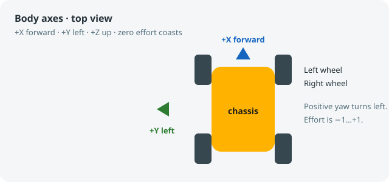
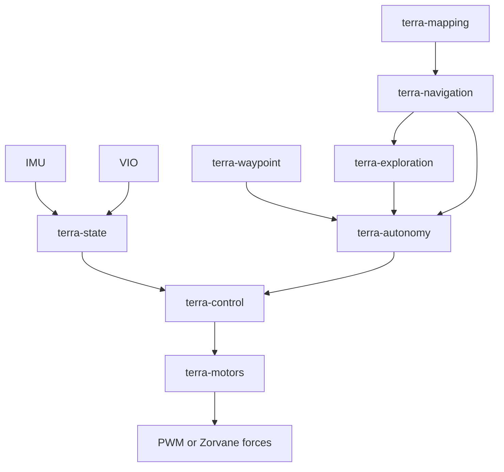
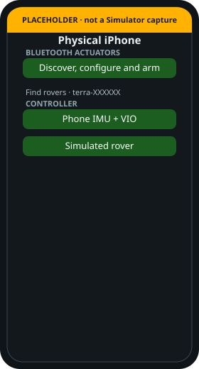
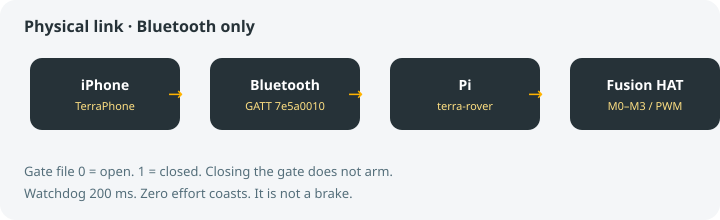
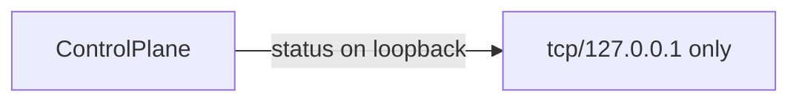
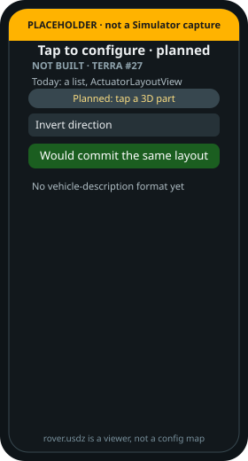

# Architecture

> [!TIP]
> **TL;DR**
> ARGOS decides. Terra drives. Zorvane pretends to be the world.
> Onboard loop: IMU and VIO, then a velocity PI, then left and right effort.
> Zero effort coasts. It does not brake.

*Every crate uses these axes. Timestamps are seconds on one clock.*

*Onboard loop. The Pi does not link these crates. It speaks Bluetooth in Python.*

## Two phone builds

| Target | Hardware link |
| --- | --- |
| iOS Simulator | **Simulated rover** only. No Bluetooth radio. |
| iPhone | Bluetooth. Path to a rover. |

`#if targetEnvironment(simulator)` chooses the section. Neither build connects to Zorvane.

**Simulated rover** is a motor plant inside the app. It is on both targets. It is not Zorvane.

*Device build.*

## Pi and Zenoh

*Customer pairing uses the USR button. Arming is a later step.*

*A listening `ControlPlane` refuses every address except loopback.*

## Planned

*#27 is not built. `rover.usdz` orbits and zooms. It does not edit actuators.*

## Current platform split

ARGOS is the React web operator interface backed by a Rust Axum server. The server
bridges browser commands and telemetry to Zenoh. ARGOS Swift is a legacy fallback;
Unity is a historical prototype. TerraPhone iOS remains the physical vehicle's
sensor, Bluetooth and shared Rust runtime. Android is an additional mobile adapter.
Zorvane owns simulation; Terra owns onboard control, mapping and autonomy.
The VLM evaluator under `tools/vlm-eval` is offline research infrastructure.
