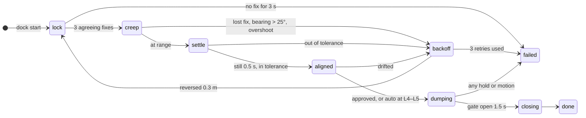

# Bucket dock and dump gate

> [!TIP]
> **TL;DR**
> Close to a confirmed bucket, `dock` lines the dump outlet up over it using live YOLO + depth
> sightings, stops, and reports `aligned`. At L0–L3 the operator approves the dump in ARGOS; at
> L4–L5 an aligned dock whose line-up the camera confirmed dumps on its own. The gate is a
> servo that Rust opens for `gate_open_seconds` and closes on every hold.

## Where each part runs

| Part | Where |
|---|---|
| Detections (box centre at median depth) | Swift / Kotlin model, `terra-mobile/src/detector.rs`; Zorvane `object_detection.rs` |
| Object map and per-frame fixes | `Runtime::observe_object` feeds both the map and the dock |
| Dock state machine, control law, corridor check | `terra-autonomy/src/dock.rs` |
| Approval policy and motion override | `terra-autonomy/src/arbiter/dock.rs` |
| Gate servo position | `Runtime::gate_servo` from the rover profile's `dock` section; `terra-mobile` puts it in the actuator frame and in `ControlOutput::gate_servo` |
| Zorvane | gate open = one NEXT DUMP press |

## Requests

`dock` follows the usual authority rules: `start` and `dump` need the current `run_id` and
`authority_revision`; `cancel` is neutral.

| Request | Effect |
|---|---|
| `{"action":"start","object_id":4,"token":"…"}` | Dock on confirmed bucket 4 from `objects`. Refused (`unknown_bucket`, `target_too_far` beyond 3 m, `emergency_stop`). Replaces a running dock. |
| `{"action":"dump","dock_id":1,"token":"…"}` | Approve the dump for dock 1 while it is `aligned`. |
| `{"action":"cancel","token":"…"}` | End the dock; an open gate closes. |

Operator teleop, a level change, a new goal and an emergency stop also end a dock.

## Status

`autonomy/status.dock`: `dock_id`, `phase`, `reason`, `object_id`, `color`, `target` (local m),
`errors` (`lateral`, `range` in m, `heading_deg`), `in_tolerance`, `fix_age`, `fixes`, `retries`,
`verified`, `approval` (`operator` or `auto`), `awaiting_approval`, `gate_open`, `elapsed`.
Decision events: `dock_started`, `dock_aligned`, `dock_gate_opened`, `dock_gate_closed`,
`dock_backoff`, `dock_done`, `dock_failed`, `dock_cancelled`.

`verified` is true when a camera fix arrived during settle, or when the last fix that had the
rover in line (within the lateral and heading tolerances) came within 0.5 m of travel of the finish
(reason `verified_blind`). The second case is Terra's normal finish: the outlet sits over the phone,
so the bucket is under the camera when lined up. A longer blind finish is `odometry_only` and not
verified. Auto-dump needs `verified`; the operator can still approve.

## Geometry and tolerances

The bucket centre is the sighting pushed 0.152 m further along the ray (the camera hits the near
wall). Aligned means the centre is within 0.05 m of the rover axis, within 0.04 m of
`outlet_ahead`, and within 6° of straight ahead, with the rover still. Rovers that cannot spin
(Terra, `allow_in_place: false`) steer within their minimum turn radius and back off in a reverse
arc when the bearing is too large; spinners turn in place.

Rover profile `dock` section (all optional):

| Field | Default | Meaning |
|---|---|---|
| `outlet_ahead` | half length + 0.152 + 0.03 m | Rover centre to outlet centre. On the phone it is the mount's camera forward offset once measured (Terra's outlet is over the phone). |
| `gate_servo` | none | Actuator id of the gate's positional servo. Without it no servo moves. |
| `gate_open` / `gate_closed` | 1 / −1 | Normalized servo positions. |
| `gate_open_seconds` | 1.5 | Open time per dump. |

On TerraPhone, Rover setup → Dump gate picks the gate servo and sets its open and closed positions,
with Try open and Try closed to check them on the rover. These replace the profile's gate and stay
across profile changes (`MobileController::set_dump_gate`, `test_dump_gate`). A running dock always
controls the gate; a dock start ends a gate test.

Terra's outlet is 3–4 in (0.076–0.10 m) wide, one tennis ball. The 0.05 m lateral tolerance keeps
it well inside a 0.30 m bucket rim.

Give the gate servo a `safe` position equal to `gate_closed` in the actuator layout, so the Pi relay
closes it when the 250 ms lease lapses.

## Limits

- A dock starts only within 3 m of the bucket and with the bucket roughly ahead; something else
  (the operator, L3, the MCP `approach_bucket`) has to bring the rover there.
- The corridor check only sees occupied cells in the occupancy grid between the rover and the
  bucket's near wall; unknown cells pass.
- L4 does not start docks on its own yet.
