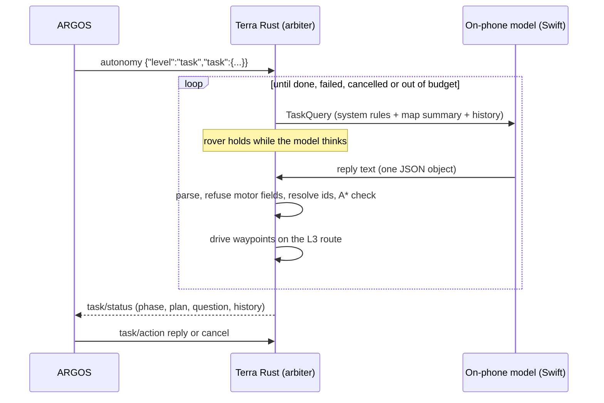

# L5 task autonomy

!!! tip "TL;DR"
    The operator types a task in ARGOS. The phone's own language model picks waypoints from the phone's occupancy map.
    Rust checks every waypoint with A* and drives it on the L3 route. The model never sends a speed or a motor command.



## Where each part runs

| Part | Where |
|---|---|
| Occupancy grid from LiDAR depth | Swift (`PhoneController`), unchanged |
| Prompt: 1 m symbolic grid, frontiers `F#`, obstacle blobs `O#`, landmarks `L#`, pose, history | Rust, `terra-autonomy/src/task.rs` |
| Model inference | Swift, `TaskModelRunner.swift`. Apple Foundation Models on iOS 26+ (`apple-foundation-models`). The `TaskLanguageModel` protocol is where an MLX or llama.cpp backend (for example Qwen2.5-VL-3B, issue #49) plugs in. |
| Reply parsing, motor-field refusal, id resolution, A* check, waypoint sequencing, timeouts, budget | Rust, `terra-autonomy/src/arbiter/task.rs` |
| Driving | The existing L3 path: waypoint follower, A* route, local planner, turning limits and every safety hold |

The model runs off the control queue. The 10 ms tick and the 20 Hz motor output do not wait for it: the rover holds (`task_planning`) until a reply is validated.

## Starting a task

The level is offered in `supported_levels` while the phone advertises a built-in model (`MobileController::set_task_model`) or an MCP agent (`MobileController::set_task_agent`). A task picks one with `"agent"`: `"builtin"` (the default) or `"mcp"`. `autonomy/status.status.task_agents` lists the ones present. A task for an answerer the phone does not have is rejected with `task_model_unavailable` or `task_agent_unavailable`.

One message selects L5 and gives the task:

```json
{"level":"task","token":"l5-1","task":{"task_id":"t1","instruction":"Go to the far side of the wall and look for the orange bucket.","budget_seconds":300,"max_steps":20}}
```

`instruction` is 1 to 500 characters. `agent` is optional (see [MCP agent](#mcp-agent)). `budget_seconds` is at most 3600 (default 300). `max_steps` is the number of model calls, 1 to 100 (default 20). A new task while already at L5 goes on `task` with the same `TaskSpec` fields plus `token` and optional `run_id`. Like `search`, it needs the current `run_id` and `authority_revision`.

`task/action`:

```json
{"task_id":"t1","action":"reply","text":"The bucket is behind the left wall.","token":"r1"}
{"task_id":"t1","action":"cancel","token":"c1"}
```

A reply answers the model's question, or adds guidance at any time. It replaces the current plan and asks the model again. Cancel is neutral, like a goal cancel: it needs no authority revision. A stop, a level change, or a goal cancel also cancels the task.

An MCP task adds two actions, both authority-bound like `reply`:

```json
{"task_id":"t1","action":"approve_drive","token":"d1"}
{"task_id":"t1","action":"deny_drive","text":"Use waypoints.","token":"d2"}
```

`approve_drive` grants the agent's pending `request_drive` for the seconds it asked (at most 60); with no request pending it is refused as `no_drive_request`. `deny_drive` refuses the request or ends a running grant, and stops the rover.

## The model's reply

One JSON object. Text around it, such as a Markdown fence, is ignored.

```json
{"decision":"go","waypoints":[{"target":"F2"},{"x":3.5,"y":-1.0}],"rationale":"see behind the wall"}
```

| `decision` | Effect |
|---|---|
| `go` | 1 to 5 waypoints, in order. An id resolves to free space beside that frontier, obstacle or landmark. A point is snapped to footprint-clear observed free space within 0.5 m. Each must have an A* route from the previous one. If the first fails, the reply is refused. If a later one fails, the plan stops there. |
| `ask_operator` | Hold and show `question` in ARGOS until a `reply`. |
| `done` | The task ends `completed`. |
| `fail` | The task ends `failed`. |

A reply that contains a motion key anywhere (`linear`, `angular`, `cmd_vel`, `velocity`, `speed`, `effort`, `pwm`, `motor`, `servo`, `throttle`, `steering`, `wheel`, `twist`) is refused as `motor_fields_forbidden`. A refused or failed reply is written into HISTORY so the next prompt tells the model what went wrong. Three failures in a row (invalid reply, model error, or no answer in 90 s) end the task `failed` with `model_failures`.

While navigating, a route failure that lasts 4 s, or a waypoint not reached in 90 s, abandons the waypoint and asks the model again with the reason.

## `task/status`

Also nested on `autonomy/status` as `task`. Fields: `run_id`, `task_id`, `instruction`, `phase` (`planning`, `navigating`, `waiting_operator`, `completed`, `failed`, `cancelled`), `reason`, `step`, `max_steps`, `elapsed_seconds`, `budget_seconds`, `remaining_seconds`, `model`, `query_id`, `waiting_seconds`, `last_latency_seconds`, `plan` (`x`, `y`, `label`), `question`, `rationale`, `last_error`, `history` (`step`, `kind`, `text`, last 12).

The arbiter tick reason while L5 holds is `task_planning`, `task_waiting_operator`, `task_completed`, `task_failed`, `task_cancelled` or `task_idle`. While driving, `active_source` is `task`.

## Landmarks

`MobileController::observe_task_landmark(label, x, y, confidence, timestamp)` adds a named point to the next prompts as `L#`. Every confirmed detector object (the YOLO bucket and ball model) is added this way as `"{color} {class} {id}"`, so a model or agent can name it in `go`.

## MCP agent

With `"agent":"mcp"` the built-in JSON loop is off. An agent drives the task through MCP tools served by Rust (`crates/terra-mobile/src/mcp.rs`, JSON-RPC 2.0, protocol `2025-06-18`): `initialize`, `ping`, `tools/list`, `tools/call`.

| Tool | Effect |
|---|---|
| `get_state`, `get_task` | Pose, level, safety, phase; the instruction, steps and time left, plan, operator answer, history. |
| `get_map` | The same text map and ids (`F#`, `O#`, `L#`, `G1`) as the built-in prompt. |
| `get_detections` | Mapped detector objects. |
| `look` | Latest camera frame (JPEG). For the on-phone agent the frame is attached to its next prompt. |
| `go_to` | 1 to 5 waypoints, checked exactly like a `go` reply, then driven by the L3 route follower. A refusal changes nothing and returns the reason. |
| `wait` | Up to 30 s until the plan ends or the operator answers. |
| `ask_operator`, `finish` | Same as `ask_operator` and `done`/`fail`. |
| `request_drive` | Ask the operator for raw drive for up to 60 s. Shown in ARGOS as `drive_request`. |
| `drive` | Only during an approved grant: linear at most 0.5 m/s, angular at most 1.0 rad/s, each command at most 1 s. It goes through the local planner like assisted teleop (`active_source` is `task_agent_drive`), so obstacles still stop it. |
| `stop` | Emergency stop, always allowed. Only the operator resets it. |

There is no tool that sets motors, the autonomy level or safety other than `stop`. Write tools need the `task` level, no stop, and a running MCP task; only one session holds a task at a time, and calls are rate limited (10 per second, one `go_to` per second). Every call is recorded as `task.agent_call`. A task with no agent call for 90 s while planning ends `failed` with `agent_timeout`; three replies from the on-phone agent without a tool call end it `failed`.

### On-phone agent

TerraPhone runs Qwen 3.5 2B (4-bit, MLX, `TaskAgentRunner.swift`). The weights download from Hugging Face on the first phone start (about 1.5 GB) and are cached; the agent is advertised once loaded. Rust owns the loop: `take_agent_prompt` returns the system prompt (tools, `<tool_call>` format), the current view and the recent calls; Swift runs the model off the control queue and hands the text back with `submit_agent_reply`. Rust parses the tool call, runs it, and only prompts again once something changed: no prompt while the rover drives a plan, waits for the operator, or waits for drive approval.

Other MCP clients reach the same tools through `MobileController::mcp_handle(session, request)`. A network listener for them is not built yet.

`task/status` adds `agent` (`builtin` or `mcp`), `drive_request` (`reason`, `seconds`, `waiting_seconds`) and `drive_remaining_seconds`. Tick reasons while an agent plans are `agent_driving`, `awaiting_drive_approval` and `awaiting_agent`.

## Not done yet

- The built-in path uses only Apple's on-device model, text-only. Qwen 3.5 2B runs through the MCP agent path instead, and sees the camera only when it calls `look`; no rendered map image yet (issue #49).
- The Qwen model id and the MLX Swift API are untested on a device; the app has not been built with the new packages in CI.
- No HTTP or Bluetooth transport for outside MCP clients.
- No model has been scored on the vlm-eval pack through this path.
- Android has no model runner.
- The model thinks while the rover holds. Planning the next step while driving the current one is not implemented.
