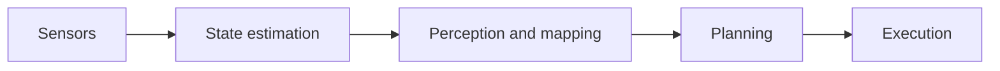

# Crates

> [!TIP]
> **TL;DR**
> One crate: `crates/terra-av`, the modular autonomy pipeline.
> The Pi (`apps/rover-pi`) is Python and does not link it.

Each stage is a trait with swappable implementations; a TOML config picks them.
See the module docs in `crates/terra-av/src/lib.rs`.
