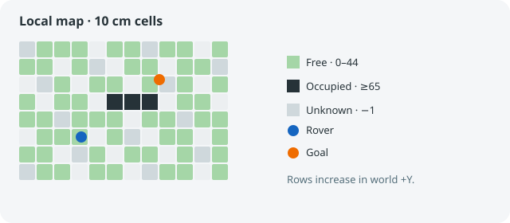
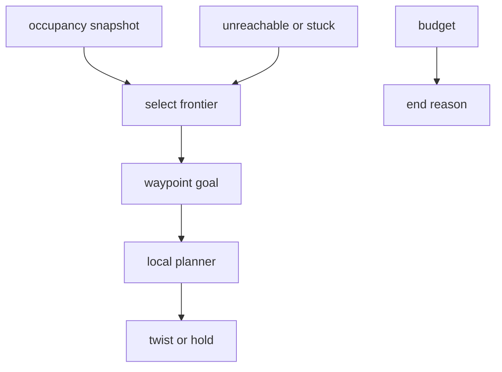

# terra-exploration

> [!TIP]
> **TL;DR**
> Explores until a time budget ends.
> Picks frontiers. Does not touch motors.
> The arbiter still drives through the local planner.

*Unknown cells are not free. A frontier is a free cell beside unknown space.*

[API](https://super-yojan.dev/Terra/api/terra_exploration/index.html) · [source](https://github.com/Super-Yojan/Terra/tree/main/crates/terra-exploration/src)

*No approval step. Supervised mode is unchanged and still waits.*

| End reason | When |
| --- | --- |
| `budget_expired` | Elapsed time reached the budget. |
| `no_frontiers_left` | No reachable unknown edge remains, including after retries are exhausted. |
| `operator_stop` | Safety stop, or a goal cancel while exploring. |
| `operator_takeover` | Level changes away from `explore`. |
| `map_stale` | The map stays missing or older than `MAP_FRESHNESS_SECONDS` (2.5 s) for 3 s (`EXPLORATION_MAP_STALE_GRACE_SECONDS`). Motion holds from the first stale tick. |
| `safety_hold` | Pose or health is not fresh. Emergency stop uses `operator_stop`. |
| `objective_complete` | The host reached the run's goal, such as the GPS destination of an outdoor explore. |

Each tick the current frontier is judged:

| Case | Result | `frontier_blocked` `why` |
| --- | --- | --- |
| Reached: within 0.2 m | Done. Next frontier, no blacklist (no event). | — |
| No unknown cells left around it | Done. Next frontier, no blacklist (`frontier_mapped`). | — |
| The frontier itself no longer fits the footprint | Blacklisted now. | `target_occupied` |
| No route, or the local planner holds | Blacklisted after `stuck_timeout` (5 s). | `unreachable` / `planner_blocked` |
| Not 0.2 m closer | Blacklisted after `no_progress_timeout` (12 s). Terra turns on a 0.5 m radius, so it drives away from a goal behind it first. | `no_progress` |

Explore uses its own 0.2 m arrival radius. With the follower's default 0.75 m, a frontier picked 0.8 m away counted as reached after a few centimetres, and the rover kept switching to new frontiers without getting to any.

A blacklisted frontier is skipped for `blacklist_seconds` (30 s) while other frontiers exist. If none is left, the best blacklisted one is retried at once (`frontier_retry_early`) instead of parking the rover. After `max_attempts` (default 3) a point stays out for the rest of the run. `frontier_retry` (Hold) now only shows when nothing at all can be retried. The look-around and `no_frontiers_left` come after that.

**Look-around.** When no frontier is reachable but unknown cells lie within reach of the body (`scan_radius` beyond the circle around it), the rover turns one full circle to see around itself. A rover whose profile allows spinning (`terra_mini`) turns in place. Terra (`allow_in_place: false`) instead drives slowly round its tightest circle, forward and else in reverse, checked by the local planner; if neither fits it holds and the look-around timeout ends it. It never falls back to spinning, and `in_place_turn` is reported only for a turn with no forward speed.

`GoalScorer` ranks frontiers; `InformationGainScorer` is the default, and the arbiter swaps in a destination-biased scorer while an outdoor GPS goal is set. `select_frontier` is the one frontier search: supervised proposals and `SearchNavigator` (target search's mission memory) use it too. This crate does not classify images.

Coverage is the area of observed free cells (occupancy 0–64), in square metres. `explored_ratio` is the fraction of cells that are no longer unknown.

While `explore` is active the arbiter caps the local-planner horizon at `timing::EXPLORATION_APPROACH_HORIZON_SECONDS` (1 s). Unknown cells stay blocked. The shorter lookahead is what lets a goal on the edge of the map be reached. Occupied cells still stop the rover.
