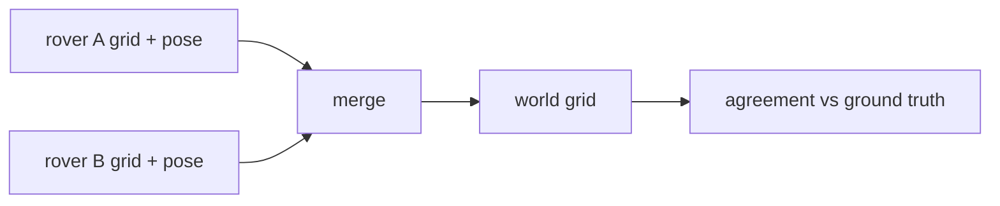

# terra-map-merge

> [!TIP]
> **TL;DR**
> Fuses several rovers' occupancy grids into one world grid.
> Each grid needs a known rover-to-world pose.
> Two rules: priority (occupied > free > unknown) and log-odds.
> No dependencies. No registration yet.

Starting point for [map fusion](../map-fusion.md) (Terra #95, Zorvane #8 / #13 / #14).



| Item | What it does |
| --- | --- |
| `Pose2` | `world = R(yaw) · local + (x, y)`. Zorvane: the spawn pose. |
| `Grid` | Same cells as `map/occupancy`: −1 unknown, 0–100, occupied ≥ 65. |
| `merge(grids, resolution, rule)` | Bounding box of all grids, nearest-cell sampling. |
| `FusionRule::Priority` | Zorvane #14 rule. One false obstacle always wins. |
| `FusionRule::LogOdds` | Sums evidence. Disagreement averages out; agreement gets more confident. |
| `agreement(map, truth)` | Accuracy, coverage, false occupied, false free. |

```sh
cargo test -p terra-map-merge
```
