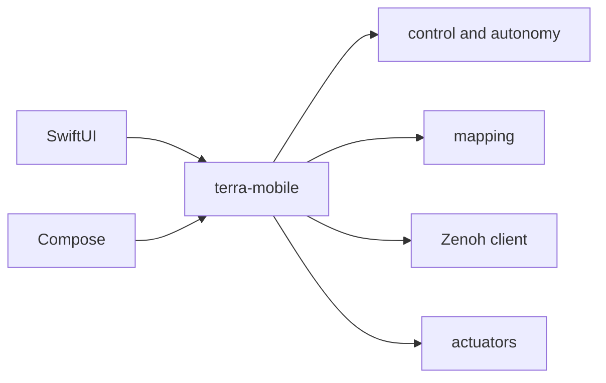
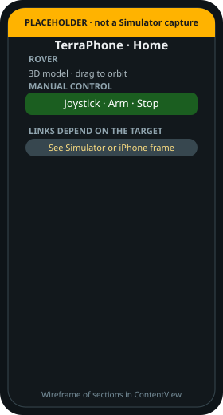

# terra-mobile

> [!TIP]
> **TL;DR**
> UniFFI boundary for TerraPhone.
> Other crates stay free of UniFFI.
> Swift bindings are generated on a Mac. Kotlin bindings are generated by `scripts/android/build-android.sh`.
> Neither binding is committed.



*[Build steps](../phone/build.md). Deployment target is iOS 17.*

## Sensor queue

`pushImu`, `pushVio`, `pushGps`, `pushHeading` and `pushCourse` only queue the sample, so they are safe to call from any sensor thread and never wait for a running control tick. Each sensor has its own bounded queue (IMU 256, VIO 64, GPS/heading/course 32); a full queue drops its oldest sample. The next time the controller locks its state (every `step`, and any call that reads state) it applies all queued samples in timestamp order, so a call always sees every sample pushed before it.

A sample the runtime rejects when it is applied (older than one already applied, or invalid) is dropped and counted instead of stopping the controller; if a sensor really stops, the freshness checks still make the output neutral. Only a nonfinite timestamp is refused at push time. `sensorQueueStats()` reports queue depths, overflow drops, rejections and the last rejection reason.

[API](https://super-yojan.dev/Terra/api/terra_mobile/index.html)

| Swift name | Rust |
| --- | --- |
| `MobileController` | Estimator, PI, arbiter, recorder. |
| `MobileWaypoint` | `terra-waypoint`. |
| `MobileOccupancyMap` | `terra-mapping`. |
| `reconnectDashboardAuthenticated` | Fleet `ControlPlane`. |
| `actuatorRouteProfiles` | `route_drive_profiles`. |



*Placeholder. The real view is SwiftUI in `ContentView`.*

When the dashboard is open, ticks can publish `autonomy/status`, `goal/status`, `exploration/status` while a run is active, `map/occupancy` (at most every 0.2 s), and `pose`. The mission picker can request `explore` with a budget in seconds.

```sh
./scripts/ios/build-ios.sh
./scripts/ios/check-swift.sh
./scripts/android/build-android.sh
```

Android steps are in [TerraPhone for Android](../MOBILE_ANDROID.md).
