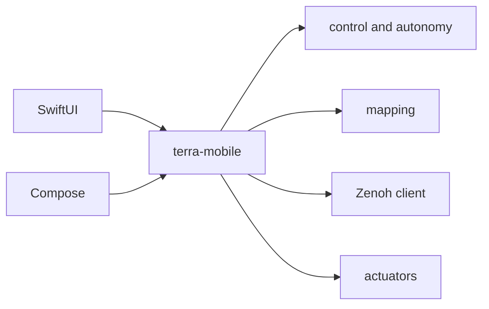
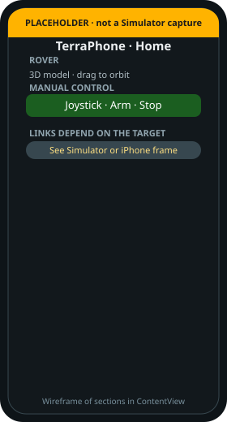

# terra-mobile

> [!TIP]
> **TL;DR**
> UniFFI boundary for TerraPhone.
> Other crates stay free of UniFFI.
> Swift bindings are generated on a Mac. Kotlin bindings are generated by `scripts/android/build-android.sh`.
> Neither binding is committed.



*[Build steps](../phone/build.md). Deployment target is iOS 17.*

## One call per tick

The app keeps the latest sample of each sensor and calls `update(sensors:)` every 10 ms with a `PhoneSensors` record: IMU, VIO, GPS, heading, course, the stick, the motor link facts and the drive source. Rust skips a sample it has already applied, so passing the same one again is harmless. The returned `MotorTick` carries a `MotorAction`:

| Action | App does |
| --- | --- |
| `drive(frameJson)` | Writes the frame to the rover. |
| `stop(reason)` | Stops the rover once per reason and shows the reason. |
| `idle` | Nothing. |

The stick is normalized effort in `[-1, 1]` in every mode; Rust scales forward by 0.5 m/s.

[API](https://super-yojan.dev/Terra/api/terra_mobile/index.html)

| Swift name | Rust |
| --- | --- |
| `MobileController` | `terra_robot::Robot`: the whole control loop. |
| `MobileWaypoint` | `terra-waypoint`. |
| `MobileOccupancyMap` | `terra-mapping`. |
| `reconnectDashboardAuthenticated` | Fleet `ControlPlane`. |
| `actuatorRouteProfiles` | `route_drive_profiles`. |



*Placeholder. The real view is SwiftUI in `ContentView`.*

When the dashboard is open, ticks can publish `autonomy/status`, `goal/status`, `exploration/status` while a run is active, `map/occupancy` (at most every 0.2 s), and `pose`. The mission picker can request `explore` with a budget in seconds.

```sh
./scripts/ios/build-ios.sh
./scripts/ios/check-swift.sh
./scripts/android/build-android.sh
```

Android steps are in [TerraPhone for Android](../MOBILE_ANDROID.md).
