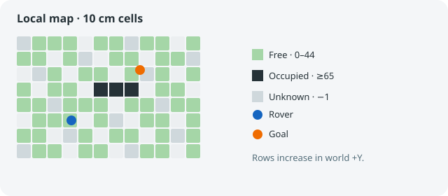
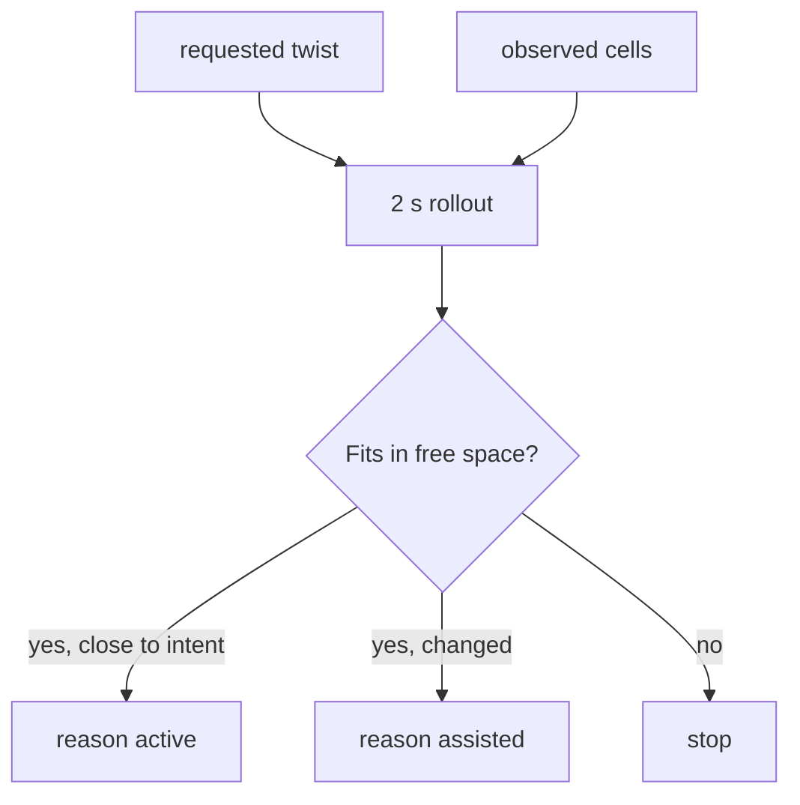

# terra-navigation

> [!TIP]
> **TL;DR**
> Plans only on cells the rover has seen.
> Occupied means probability ≥ 65.
> The rover is a rectangle checked at its heading, and turns only along arcs.
> A frontier is a proposal. It does not move the rover by itself.
> Autonomous runs live in terra-exploration.

*Unknown cells are not free. The default body is Terra: 0.61 m square with 5 cm margin.*

[API](https://super-yojan.dev/Terra/api/terra_navigation/index.html) · [source](https://github.com/Super-Yojan/Terra/blob/main/crates/terra-navigation/src/lib.rs)

*Caps: 2 m/s, 2 rad/s, 1 m/s², 2 rad/s² yaw.*

**The body.** A `Footprint` is the rover's length, width and a margin on every side. A cell blocks the body if the rectangle, rotated to the rover's heading, overlaps it at all: occupied cells (≥ 65), off-map cells, and unknown cells except those under the body where the rover starts. Checking the real rectangle instead of the circle around it lets the rover line itself up and pass gaps narrower than its diagonal: Terra (0.71 m with margin) needs about 0.76 m square-on, where the old 0.65 m circle needed 1.3 m.

**Routes: Hybrid A\*.** `RouteJob` searches over position and heading. Each step is a short arc no tighter than `min_turn_radius`, forward or in reverse, so routes never ask the rover to turn in place. The search keeps about 0.3 m from obstacles where there is room and hugs them only when a gap demands it. The arbiter advances it 150 expansions per control tick (about 1.5 ms), so a 10 ms tick never stalls; the rover holds with `route_planning` until the first route is ready.

**Goals in unseen space (issue #109).** A route first stays in seen free space. If there is none, it may cross unseen cells at three times the cost, and only the seen, free start of that route is returned: the rover drives to the edge of what it has seen, the map fills in, and the arbiter replans every 0.2 s, so a goal behind a box is reached by going round it. A goal whose body would touch a seen obstacle moves to the nearest point (within the arrival radius less 0.1 m) where the body fits; a goal off the map moves inside it. A goal on an obstacle cell, or one sealed off by seen obstacles, is refused. The local planner checks the same rectangle along every candidate motion.

**Getting unstuck.** On routed levels the arbiter does not wait forever when the local planner keeps holding with `obstacle_blocked`. After 1 s it replans from where the rover stands (Hybrid A\* may now start in reverse). If it is still blocked, or no route can start because the body already touches an obstacle cell (`route_start_blocked`, often map noise), it reverses straight back at 0.08 m/s for up to 0.25 m. `backoff_clear` checks that reverse every tick: it may leave cells the body touches ahead of its centre, but never enter occupied, unknown or off-map cells behind. Then it replans. If that fails too, or it cannot reverse, it holds with `boxed_in` (a route failure) and starts over after 5 s, or at once for a new goal.

**Heading-free checks.** `frontier`, `reachable` and `footprint_clear` ask whether the body fits at a cell at *some* heading, using a cached `FitGrid`. They ignore the turning radius, so they only rank candidates; approval and task waypoints are confirmed with Hybrid A\*. `terra-exploration` uses the same helpers and adds the time budget, blacklist, and stop reasons. `observed_clearance` (distance from the rectangle to the nearest obstacle) feeds near-miss logs in `terra-experiment`.
