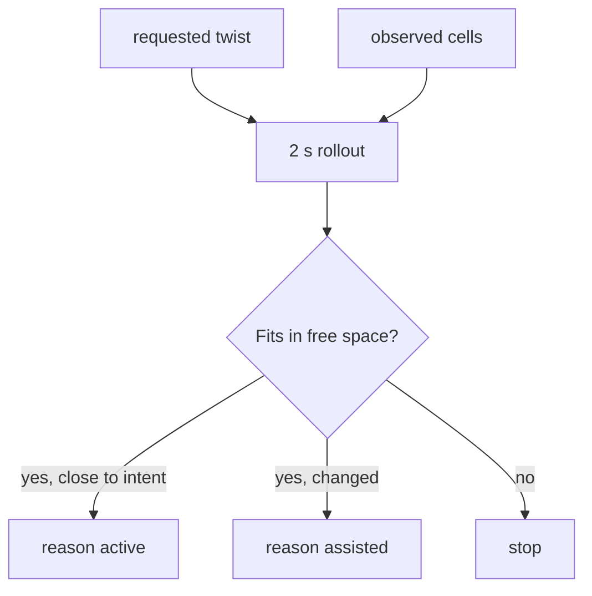

# terra-navigation

> [!TIP]
> **TL;DR**
> Plans only on cells the rover has seen.
> Occupied means probability ≥ 65.
> A frontier is a proposal. It does not move the rover by itself.
> Autonomous runs live in terra-exploration.

*Unknown cells are not free. Default footprint radius is 0.65 m.*

[API](https://super-yojan.dev/Terra/api/terra_navigation/index.html) · [source](https://github.com/Super-Yojan/Terra/blob/main/crates/terra-navigation/src/lib.rs)

*Caps: 2 m/s, 2 rad/s, 1 m/s², 2 rad/s² yaw.*

**L3 goals in unseen space (issue #109).** `astar_progress_route` first tries an exact route over seen cells. If that fails, it searches again with unseen cells passable at three times the cost, then returns only the part of that route that is seen and free. The rover drives to the edge of what it has seen, the map fills in, and the arbiter replans every 0.2 s, so a goal behind a box is reached by going round the box. A goal whose footprint touches a seen obstacle moves to the nearest cell (within the arrival radius less 0.1 m) where the rover fits. A goal on an obstacle cell, or one sealed off by seen obstacles, is still refused. The local planner and every returned route edge still treat unseen cells as blocked.

`frontier` searches inflated free cells for supervised proposals. `terra-exploration` uses the same clearance helpers and adds the time budget, blacklist, and stop reasons. `observed_clearance` feeds near-miss logs in `terra-experiment`.
