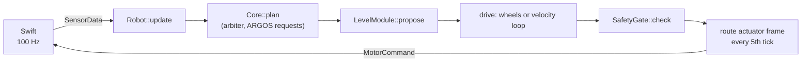

# terra-robot

> [!TIP]
> **TL;DR**
> One rover's whole control loop, with no I/O.
> The phone calls `Robot::update(&SensorData) -> MotorCommand` once per tick and sends what it returns.
> Inside: the level module proposes, the safety gate decides, the actuator frame is routed.
> Zorvane runs the inner `Core` directly.

[API](https://super-yojan.dev/Terra/api/terra_robot/index.html) · [source](https://github.com/Super-Yojan/Terra/blob/main/crates/terra-robot/src/robot.rs)



*Swift only samples sensors, runs the radio and draws the screen.*

## One tick

| Step | Where | Does |
| --- | --- | --- |
| 1 | `Robot::apply_sensors` | Applies each sample newer than the last one seen. The stick is ignored while an ARGOS link owns intent. |
| 2 | `service_link` | Handles a failed link, feeds queued ARGOS requests, advances a point capture. |
| 3 | `Core::plan` | The arbiter picks the level's twist, status and authority. |
| 4 | `module_for(level)` | On a level change: `on_exit`, swap module, `on_enter`. |
| 5 | `LevelModule::propose` | Returns a `Motion`: `Stop`, `Wheels`, `Velocity` or `Planned`. A bucket dock overrides it with `Planned`. |
| 6 | `drive` | Wheels pass through; `Velocity` and `Planned` run the velocity loop. |
| 7 | `SafetyGate::check` | `Idle`, `Drive` or `Stop(reason)`. A stop zeroes the wheels. |
| 8 | `Core::finish`, `report` | Status, recording, ARGOS telemetry. |
| 9 | route | On every 5th tick (20 Hz) a `Drive` verdict becomes an actuator frame. |

### Level modules

```rust
pub trait LevelModule: Send {
    fn on_enter(&mut self, _tick: &Tick) {}
    fn on_exit(&mut self) {}
    fn propose(&mut self, tick: &Tick) -> Proposal;
}
```

| Level | Module | Notes |
| --- | --- | --- |
| L0 Teleop | `levels::Teleop` | Phone stick: wheels (direct effort) or a velocity target. ARGOS teleop keeps the managed turning limits. Input older than the lease is a stop. |
| L1 to L5 | `levels::Planned` | Temporary adapter: the arbiter still plans. Each level moves into its own module next. |

### Safety gate

| Check | Verdict |
| --- | --- |
| No rover link | `Idle` |
| Emergency stop (operator, router or tilt) | `Stop` |
| Proposal input older than 0.5 s | `Stop` |
| Camera tracking lost in a tracking-dependent level | `Stop` |
| Autonomous level without left/right wheel routes | `Stop` |
| Feedback or autonomy without a ready phone pose | `Stop` |
| Link not armed, or feedback layout incompatible | `Idle` |
| Mount not confirmed (except the local debug stick) | `Stop` once, then `Idle` |
| Otherwise | `Drive` |

`Robot::stop_reason()` keeps the first stop cause until `clear_stop_reason()`.

## The core

`Core` is the arbiter, estimator, velocity loop, map and request admission. Create it from a `CoreConfig`, then ingest timestamped `Event`s: IMU, VIO, maps, local manual or velocity input, remote requests, link changes, hardware status, GPS and heading. Time is monotonic seconds from the host. Equal-time events keep arrival order and a step backwards in time fails. A sensor sample cannot be stamped after it was received.

Remote requests are named by `terra_types::requests`. Each is checked against the current run and authority revision and its original receipt age when it runs, and stops run last in a queued batch. Losing the link retires remote driving without replaying input; the router-loss policy (`connectivity`) may keep an accepted onboard mission running while local evidence stays valid.

`Core::step(now)` (plan, track and finish in one call, as Zorvane uses it) returns a `CoreOutput`:

| Field | Holds |
| --- | --- |
| `autonomy` | The arbiter's output: twist, status, goal, proposal, search, task, decision events. |
| `motor` | Left and right effort for the wheels. |
| `status` | The full status record, the same JSON as `status_json()`. |
| `drive` | What the wheels did (reversing, stall time) for the dashboard. |
| `events` | Runtime events to journal. |
| `clearance` | Observed clearance around the body, metres; `None` without a pose or a nearby obstacle. |

`telemetry()` turns it into one payload per `terra_types::telemetry` topic, including `pose` while the pose is ready. `search_reports()` lists the reports still waiting for acknowledgement. `terra_robot::ControlTickRecord` turns it into the recorded `control_tick` line.

## Near misses

Each tick measures observed clearance at the tracked pose (`terra_navigation::observed_clearance`). Below 0.3 m it adds a `near_miss_start` decision event, and above 0.4 m a `near_miss_end`, once per episode (`near_miss`).

## Missing pose

Without a tracked pose nothing is measured at the origin. Arbiter queries that need a position take `Option<Pose>`: any latched goal counts as active, a dock does not start (`pose_unavailable`), and the task agent's map view and plans are refused. The arbiter itself still runs, for local teleop, with a placeholder pose that is never fresh.

## Modes

`DirectEffort` keeps the phone's normalized manual mixing. Autonomous levels use `VelocityFeedback`. Changing mode clears operator intent and the controller's accumulated state. Managed turning limits never apply to local manual input.

## Map and floor

`MappingState` is a shared handle, so platform camera callbacks integrate depth into the same mapper. `ground::GroundPolicy` is the phone's floor and mount policy. Simulated clearance uses the camera mount and body size, not terrain height. The core's source revision, configuration identity and actuation mode appear in every status record.

## Checks

- `cargo test -p terra-robot -p terra-mobile`: policy, gate, the `update` entry point and phone replay.

Zorvane's `terra-source.json` pins one Terra checkout for every Terra dependency. Update it only after the matching Terra revision is pushed.
