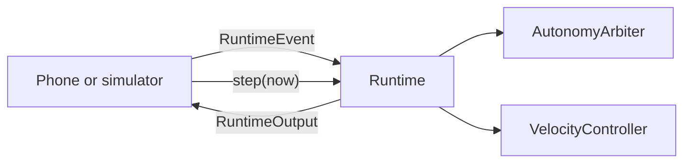

# terra-runtime

> [!TIP]
> **TL;DR**
> One rover's control loop, with no I/O.
> Hosts feed `RuntimeEvent`s, call `step(now)` at 100 Hz, and publish what it returns.
> TerraPhone (through `terra-mobile`) and each Zorvane rover run the same code.

[API](https://super-yojan.dev/Terra/api/terra_runtime/index.html) · [source](https://github.com/Super-Yojan/Terra/blob/main/crates/terra-runtime/src/lib.rs)

*The runtime owns the estimator, controller, map, arbiter and request admission. Transport and recording stay in the host.*

## A tick

Create a `RuntimeConfig`, then ingest timestamped events: IMU, VIO, maps, local manual or velocity input, remote requests, link changes, hardware status, GPS and heading. Time is monotonic seconds from the host. Equal-time events keep arrival order and a step backwards in time fails. A sensor sample cannot be stamped after it was received.

Remote requests are named by `terra_types::requests`. Each is checked against the current run and authority revision and its original receipt age when it runs, and stops run last in a queued batch. Losing the link retires remote driving without replaying input; the router-loss policy (`connectivity`) may keep an accepted onboard mission running while local evidence stays valid.

`step(now)` returns a `RuntimeOutput`:

| Field | Holds |
| --- | --- |
| `autonomy` | The arbiter's output: twist, status, goal, proposal, search, task, decision events. |
| `motor` | Left and right effort for the wheels. |
| `status` | The full status record, the same JSON as `status_json()`. |
| `drive` | What the wheels did (reversing, stall time) for the dashboard. |
| `events` | Runtime events to journal. |
| `clearance` | Observed clearance around the body, metres; `None` without a pose or a nearby obstacle. |

`telemetry()` turns it into one payload per `terra_types::telemetry` topic, including `pose` while the pose is ready. `search_reports()` lists the reports still waiting for acknowledgement. `terra_experiment::ControlTickRecord` turns it into the recorded `control_tick` line.

## Near misses

Each tick measures observed clearance at the tracked pose (`terra_navigation::observed_clearance`). Below 0.3 m it adds a `near_miss_start` decision event, and above 0.4 m a `near_miss_end`, once per episode (`near_miss`).

## Missing pose

Without a tracked pose nothing is measured at the origin. Arbiter queries that need a position take `Option<Pose>`: any latched goal counts as active, a dock does not start (`pose_unavailable`), and the task agent's map view and plans are refused. The arbiter itself still runs, for local teleop, with a placeholder pose that is never fresh.

## Modes

`DirectEffort` keeps the phone's normalized manual mixing. Autonomous levels use `VelocityFeedback`. Changing mode clears operator intent and the controller's accumulated state. Managed turning limits never apply to local manual input.

## Map and floor

`MappingState` is a shared handle, so platform camera callbacks integrate depth into the same mapper. `ground::GroundPolicy` is the phone's floor and mount policy. Simulated clearance uses the camera mount and body size, not terrain height. The runtime's source revision, configuration identity and actuation mode appear in every status record.

## Checks

- `cargo test -p terra-runtime -p terra-mobile`: policy and phone replay.
- `node scripts/checks/check-runtime-parity.mjs`: the same trace natively and in WebAssembly. Discrete status hashes must match; effort and twist within 1e-5. Needs Node and the `wasm32-unknown-unknown` target.

Zorvane's `terra-source.json` pins one Terra checkout for every Terra dependency. Update it only after the matching Terra revision is pushed.
