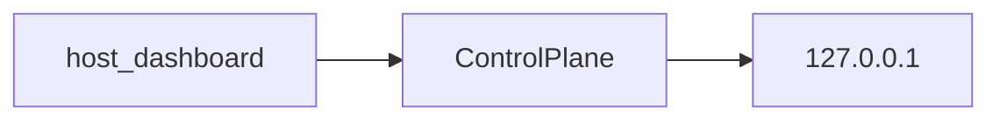

# terra-transport

> [!TIP]
> **TL;DR**
> `ControlPlane` listens only on `tcp/127.0.0.1`, or connects out to a configured router.
> Stops are never evicted from the intent inbox and are drained last.



*UDP is rejected. Multicast scouting is off. Connect timeout is 2 s.*

[API](https://super-yojan.dev/Terra/api/terra_transport/index.html) · [readme](https://github.com/Super-Yojan/Terra/blob/main/crates/terra-transport/README.md)

## Loopback plane

Accepts `autonomy`, `safety`, `goal`, `goal/decision`, `teleop`, and `cmd_vel`.

Publishes `terra/rover/fleet/state` every 100 ms for that one rover id.

```sh
cargo test -p terra-transport
```

WebRTC signaling uses the same session and a separate queue. The cap is 65536 bytes. Control messages stay at 2048. Message types live in [fpv-signaling](fpv-signaling.md). See [FPV video](../phone/fpv.md).

RGB, a client fleet subscription, and reconnect UI are planned.
