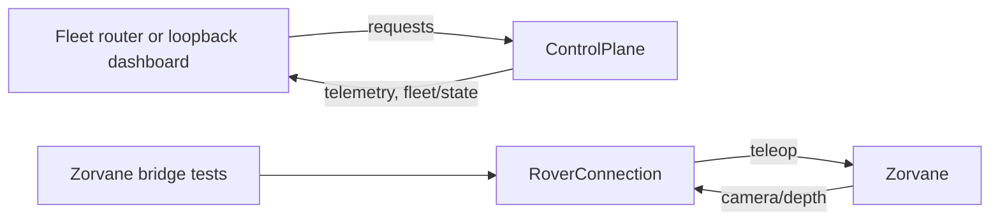
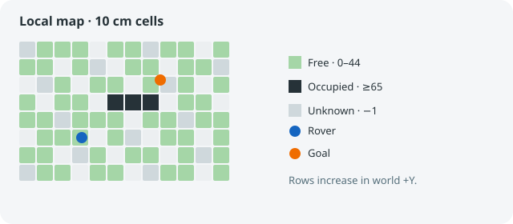

# terra-transport

> [!TIP]
> **TL;DR**
> `ControlPlane` is the phone's Zenoh session: operator requests in, telemetry out.
> It either listens on `tcp/127.0.0.1` or connects out to a fleet router.
> `RoverConnection` is the simulator client for Zorvane. It publishes `teleop` at 20 Hz and drops the lease after 250 ms.



*UDP is rejected. Multicast scouting is off. Router settings are checked by `validate` before any session opens.*

[API](https://super-yojan.dev/Terra/api/terra_transport/index.html) · [readme](https://github.com/Super-Yojan/Terra/blob/main/crates/terra-transport/README.md)

## Control plane

Admits only the request topics in `terra_types::requests` (`autonomy`, `teleop`, `safety`, `goal`, `goal/decision`, `navigation/*`, `search*`, `task*`, `dock`), each at most 2048 bytes. Stops are drained last so they win the tick.

Publishes only the telemetry topics in `terra_types::telemetry`, each with its own byte cap and delivery: state replays while fresh (500 ms), visualization goes once per sample, `search/report` replays as a batch, and `pointcloud/full` goes on its own bulk queue. While a producer is fresh it also advertises `<prefix>/fleet/state` every 100 ms.

WebRTC signaling uses the same session and a separate queue. The cap is 65536 bytes. Message types live in [fpv-signaling](fpv-signaling.md). See [FPV video](../phone/fpv.md).

## Simulator client

`set_target` allows ±2 m/s and ±2 rad/s. An invalid target forgets the previous one. Disconnect publishes a final zero.

`status` means the socket is open. It does not mean the wheels moved.



*Subscribe key: `terra/rover/<id>/camera/depth`. Encoding `32FC1_LE`.*

```sh
cargo test -p terra-transport
```
