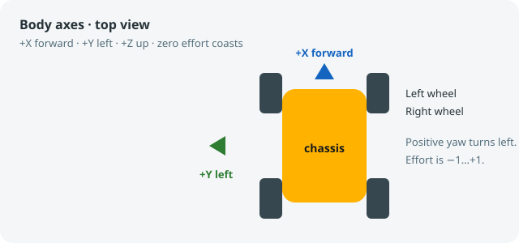
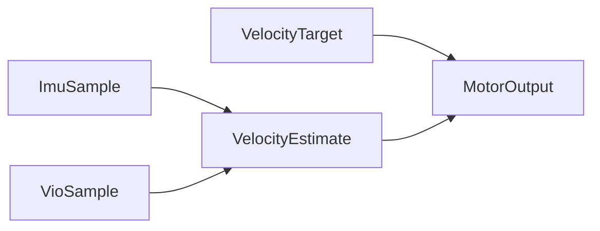

# terra-types

> [!TIP]
> **TL;DR**
> Shared geometry and samples.
> Body axes: +X forward, +Y left, +Z up.
> Motor effort is −1…+1. Zero coasts.

*Source of the axes. Later crates do not redefine them.*

[API](https://super-yojan.dev/Terra/api/terra_types/index.html) · [source](https://github.com/Super-Yojan/Terra/blob/main/crates/terra-types/src/lib.rs)

## What you pass around

*One monotonic clock, in seconds.*

| Type | Keep |
| --- | --- |
| `ImuSample` | Gravity-free m/s². Gyro in rad/s. |
| `VioSample` | Pose, world velocity, `tracked`. |
| `VelocityTarget` | `forward` m/s and `yaw_rate` rad/s. |
| `MotorOutput` | `left` and `right` effort. `stop_reason` if neutral. |

`Health` is missing, stale, or untracked sensors.

`InputError` is a bad number, a bad quaternion, or a clock that went backwards.

`Quaternion::rotate` wants a normalized quaternion.

`wrap_angle` wraps radians to [−π, π). Use it instead of a local copy.

## Shared tables

| Module | Holds |
| --- | --- |
| `requests` | Operator request topics (`autonomy`, `teleop`, `safety`, `goal`, ...), with the authority, envelope and stop rule for each. Transport admits only these suffixes; the runtime reads the same rows. Payloads are capped at 2048 bytes. |
| `telemetry` | Outbound topics, each with its byte cap and delivery (state, visualization, batch, bulk). The phone names topics from here and transport admits only these. |
| `point_capture` | The `pointcloud/request` → `pointcloud/full` labelled capture: request, `TPC1` frame and progress. |
| `timing` | Every timing default in seconds, and `fresh(now, time, limit)`: finite, not in the future, age < limit. |
| `turning` | `TurningConfig` and the managed yaw-rate limiter for autonomous and fleet commands. Local manual driving skips it. |
