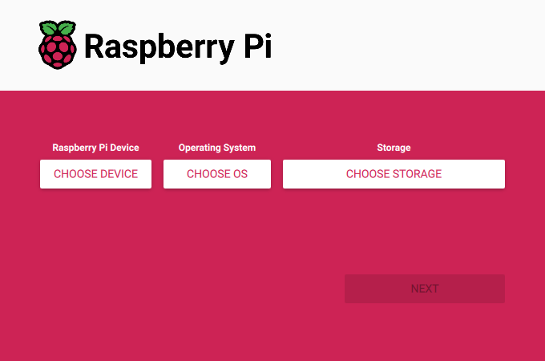
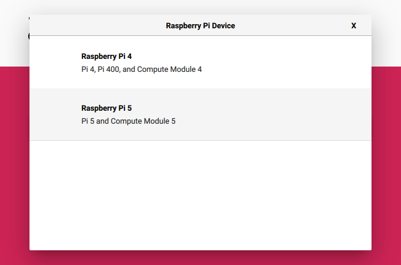
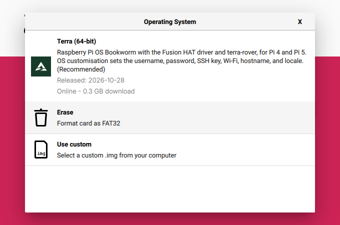
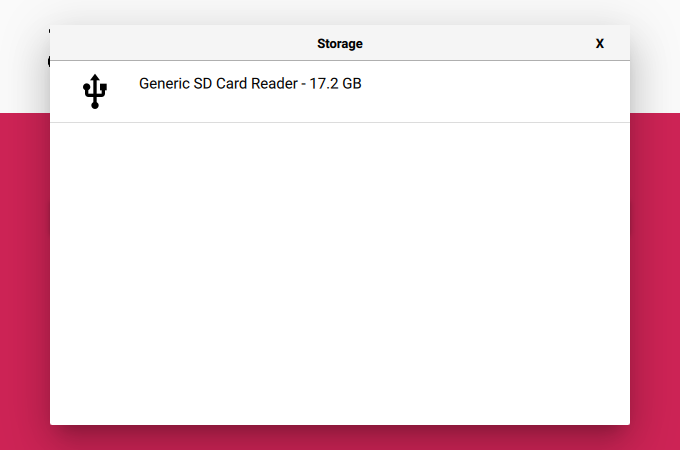
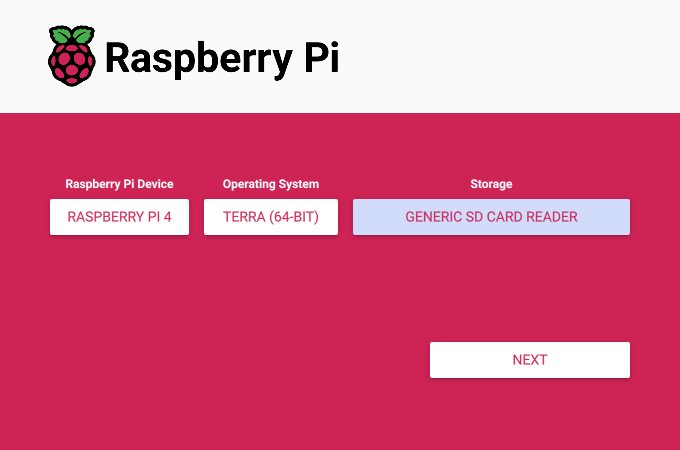
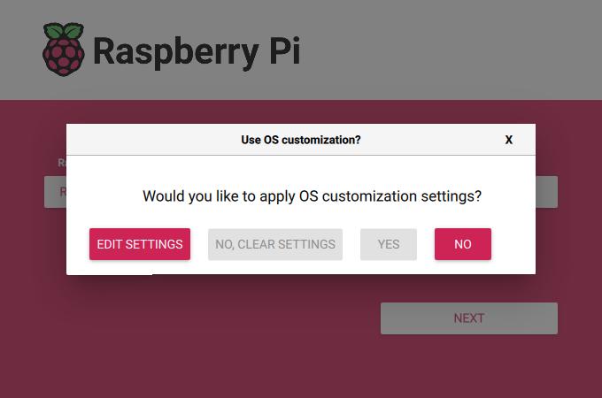
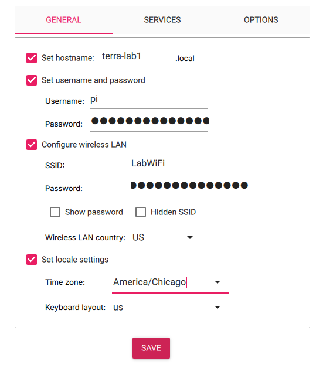
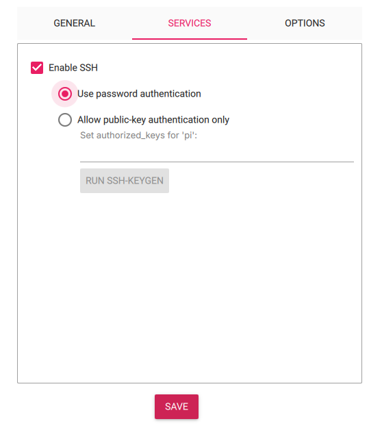
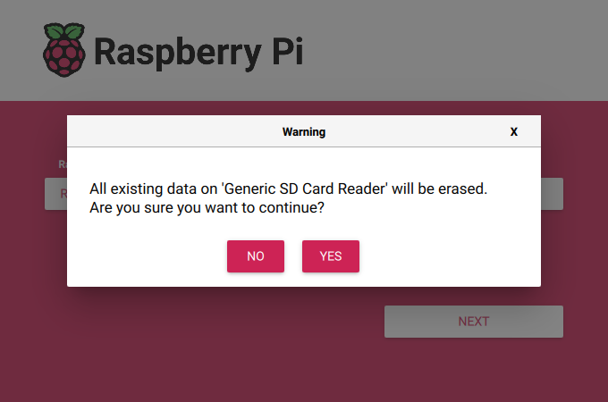

# Flash the Terra SD card

> [!TIP]
> **TL;DR**
> Open Raspberry Pi Imager on the Terra OS list. Pick your Pi, **Terra (64-bit)**, and the card.
> Set a username, password, Wi-Fi and SSH in **Edit settings**. Write. Boot.
> The card already has the Fusion HAT driver and `terra-rover`. Nothing to install.

The Terra image is 64-bit Raspberry Pi OS Bookworm for the **Raspberry Pi 4 and Pi 5**.
It is built by [terra-image-gen](https://github.com/Super-Yojan/terra-image-gen) and
published on its [releases page](https://github.com/Super-Yojan/terra-image-gen/releases).
The image contains:

- the Fusion HAT kernel driver (DKMS, so a kernel update can rebuild it),
- `terra-rover` from the matching [Terra release](https://github.com/Super-Yojan/Terra/releases),
  enabled as `terra-rover.service`,
- SSH over USB (Pi 4), Ethernet and Wi-Fi, and a `Terra-` hotspot when no saved Wi-Fi connects.

It does not contain a password, a Wi-Fi password, an SSH key, or a paired phone.
Imager adds the first three while it writes the card. You pair the phone after boot.

You need a microSD card of **8 GB or more**, a card reader, and
[Raspberry Pi Imager](https://www.raspberrypi.com/software/) 1.8 or newer.

## 1. Open Imager on the Terra OS list

Quit Imager if it is open. Then start it with the Terra list. This address always
points at the newest Terra image:

```text
https://github.com/Super-Yojan/terra-image-gen/releases/latest/download/terra-os-list.json
```

**macOS**

```sh
open -a 'Raspberry Pi Imager' --args --repo https://github.com/Super-Yojan/terra-image-gen/releases/latest/download/terra-os-list.json
```

**Linux**

```sh
rpi-imager --repo https://github.com/Super-Yojan/terra-image-gen/releases/latest/download/terra-os-list.json
```

**Windows**

```bat
"%ProgramFiles%\Raspberry Pi Imager\rpi-imager.exe" --repo https://github.com/Super-Yojan/terra-image-gen/releases/latest/download/terra-os-list.json
```



*Imager opens with three choices: device, operating system, and storage.*

## 2. Choose the device

Click **Choose Device** and pick **Raspberry Pi 4** or **Raspberry Pi 5**. The Terra
list only offers these two.



## 3. Choose Terra

Click **Choose OS** and pick **Terra (64-bit)**. The release date is the date of the
image the list points at. You do not need the full Raspberry Pi OS catalog.



## 4. Choose the card

Insert the card. Click **Choose Storage** and pick it. Check the size so you do
not pick another drive.



All three buttons now show your choices. Click **Next**.



## 5. Set the login, Wi-Fi and SSH

Imager asks whether to apply OS customisation. Click **Edit settings**.



On the **General** tab:

- **Hostname**: a name for this rover, for example `terra-lab1`. Leave it unticked
  and the card names itself `terra-` plus the last six hex digits of the Pi serial.
- **Username and password**: this is the only login password. The image has none of its own.
- **Wireless LAN**: SSID, password, and the country the network is in.
- **Locale**: time zone and keyboard.



On the **Services** tab, tick **Enable SSH**. Choose **Use password authentication**
to log in with the password above, or **Allow public-key authentication only** and
paste your public key (for example the contents of `~/.ssh/id_ed25519.pub`).



Click **Save**, then **Yes** to apply the settings.

## 6. Write the card

Imager warns that everything on the card will be erased. Check the name, then
click **Yes**.



Imager downloads the image (about 0.3 GB), checks its size and sha256 against the
OS list, writes it, and verifies the card. When it says the write succeeded,
remove the card.

## 7. First boot

Put the card in the Pi and power it on. The first start applies your Imager
settings and reboots once. The second start grows the filesystem to the card,
creates the SSH host keys, and starts `terra-rover`. Give it about two minutes.

Connect with the hostname and username you set:

```sh
ssh pi@terra-lab1.local
```

If `.local` names do not resolve on your network, use one of these:

| Link | Address | Notes |
| --- | --- | --- |
| Wi-Fi or Ethernet | DHCP lease from the router | Look the Pi up on the router. |
| USB-C cable (Pi 4 only) | `192.168.77.1` | Use a data cable to the USB-C port. Works whether or not Wi-Fi is up. |
| `Terra-xxxxxx` hotspot | `192.168.78.1` | Starts when no saved Wi-Fi connects within 30 s. |

The hotspot password is generated on each card. Read it over USB SSH from
`/etc/terra-image/network.conf`. The full network options are in the
[image README](https://github.com/Super-Yojan/terra-image-gen/blob/master/examples/terra/README.md).

`sudo` does not ask for a password.

## 8. Pair TerraPhone

Hold the Fusion HAT **USR** button for three seconds. The LED blinks slowly and a
60-second pairing window opens. Accept **Connect** for **terra-XXXXXX** in TerraPhone.
Three flashes mean the owner is saved. Then set the actuator layout in TerraPhone.
The full pairing steps are in [Install](INSTALL.md#pair-the-owner-and-run).

The Pi is a relay: it holds each drive command from the phone for 250 ms and then
returns every output to its safe value. Keep the external battery switch within
reach the first time the wheels move. See [Bench procedure](BENCH.md).

## Check what is on the card

```sh
cat /etc/terra-image-release
systemctl status terra-rover
```

`/etc/terra-image-release` lists the `terra-rover` version, the Terra commit, the
Fusion HAT driver, and the kernel packages in the image.

## Notes

- **Imager 2.x** looks different from the screenshots (taken with Imager 1.8.5), but
  the steps are the same. It asks for the customisation settings as pages of the
  wizard instead of a dialog.
- **A downloaded `.img.xz` file** can be written with **Use custom**. Imager 2.x
  then skips customisation, so open Imager with the `--repo` command in step 1
  if you want the settings.
- **Without Imager**, put an `authorized_keys` file, a `wpa_supplicant.conf`, or a
  `custom.toml` on the card's boot partition. First boot copies them in and deletes
  them from the card. See the [image README](https://github.com/Super-Yojan/terra-image-gen/blob/master/examples/terra/README.md#first-boot).
- **An existing Pi** that already runs Raspberry Pi OS can install the release by
  hand instead. See [Install](INSTALL.md).
