# Raspberry Pi hardware: function UML

This is a **historical implementation snapshot** from before the Pi motor relay simplification. Source links are pinned to that revision; the diagrams do not describe the current implementation. It includes every explicitly defined Python function and method under `hardware/raspberry-pi/terra_rover/`, including private helpers, nested callbacks, async functions, and property accessors. `rover.py` is the executable wrapper. Tests, build dependencies, third-party drivers, and implicit/generated methods are excluded. The phone app is outside this scope.

Each module has a Mermaid UML class diagram. `ModuleFunctions` groups free functions; `Callbacks` groups functions defined inside another function. These groups are documentation containers, not runtime classes. Signatures show parameter names without defaults or type annotations; `self`/`cls` are omitted, and variadic parameters use `args_`/`kwargs_` prefixes. `+` means a public name and `-` means a leading-underscore name; Python does not enforce this visibility. Getter/setter definitions may share a name.

Class arrows show inheritance. In the overview, dashed arrows show direct relative imports, not every possible runtime call. The sequence diagram is a representative drive iteration; configuration, error handling, and lifecycle branches are listed in the module diagrams.

## Module dependencies

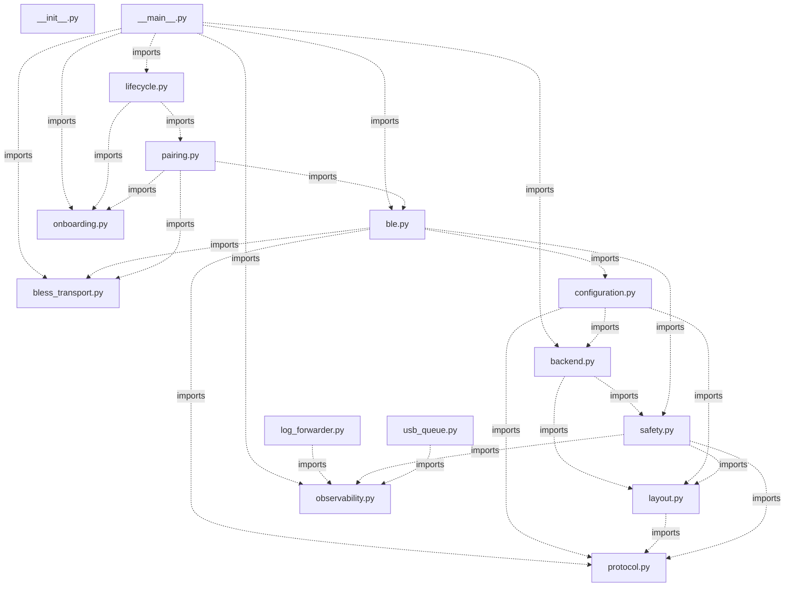

The package `__init__.py` has no explicit function definitions. `rover.py` imports and invokes `terra_rover.__main__.main()`.

## Drive command path

Snapshot timing: drive-fragment assembly expires at 100 ms, the output worker targets a 10 ms loop, the motion watchdog expires at 200 ms, and recurring status publication targets 100 ms. The watchdog and arming rules remain present in this diagram because they are present in the source.

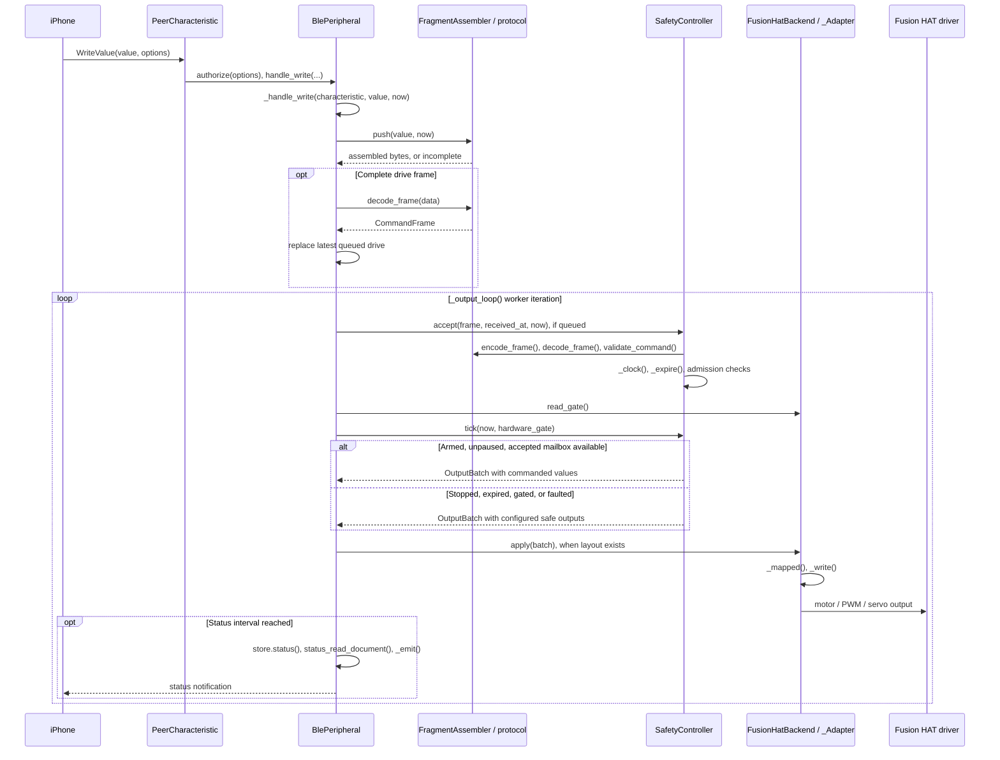

## Function inventory

| Module | Explicit functions and methods |
| --- | ---: |
| [rover.py](https://github.com/Super-Yojan/Terra/blob/8695cf67992647c163142cf3f3b6d81aaaba4bd0/hardware/raspberry-pi/rover.py) | 0 |
| [terra_rover/__init__.py](https://github.com/Super-Yojan/Terra/blob/8695cf67992647c163142cf3f3b6d81aaaba4bd0/hardware/raspberry-pi/terra_rover/__init__.py) | 0 |
| [terra_rover/__main__.py](https://github.com/Super-Yojan/Terra/blob/8695cf67992647c163142cf3f3b6d81aaaba4bd0/hardware/raspberry-pi/terra_rover/__main__.py) | 17 |
| [terra_rover/backend.py](https://github.com/Super-Yojan/Terra/blob/8695cf67992647c163142cf3f3b6d81aaaba4bd0/hardware/raspberry-pi/terra_rover/backend.py) | 37 |
| [terra_rover/ble.py](https://github.com/Super-Yojan/Terra/blob/8695cf67992647c163142cf3f3b6d81aaaba4bd0/hardware/raspberry-pi/terra_rover/ble.py) | 27 |
| [terra_rover/bless_transport.py](https://github.com/Super-Yojan/Terra/blob/8695cf67992647c163142cf3f3b6d81aaaba4bd0/hardware/raspberry-pi/terra_rover/bless_transport.py) | 18 |
| [terra_rover/configuration.py](https://github.com/Super-Yojan/Terra/blob/8695cf67992647c163142cf3f3b6d81aaaba4bd0/hardware/raspberry-pi/terra_rover/configuration.py) | 24 |
| [terra_rover/layout.py](https://github.com/Super-Yojan/Terra/blob/8695cf67992647c163142cf3f3b6d81aaaba4bd0/hardware/raspberry-pi/terra_rover/layout.py) | 6 |
| [terra_rover/lifecycle.py](https://github.com/Super-Yojan/Terra/blob/8695cf67992647c163142cf3f3b6d81aaaba4bd0/hardware/raspberry-pi/terra_rover/lifecycle.py) | 4 |
| [terra_rover/log_forwarder.py](https://github.com/Super-Yojan/Terra/blob/8695cf67992647c163142cf3f3b6d81aaaba4bd0/hardware/raspberry-pi/terra_rover/log_forwarder.py) | 2 |
| [terra_rover/observability.py](https://github.com/Super-Yojan/Terra/blob/8695cf67992647c163142cf3f3b6d81aaaba4bd0/hardware/raspberry-pi/terra_rover/observability.py) | 18 |
| [terra_rover/onboarding.py](https://github.com/Super-Yojan/Terra/blob/8695cf67992647c163142cf3f3b6d81aaaba4bd0/hardware/raspberry-pi/terra_rover/onboarding.py) | 11 |
| [terra_rover/pairing.py](https://github.com/Super-Yojan/Terra/blob/8695cf67992647c163142cf3f3b6d81aaaba4bd0/hardware/raspberry-pi/terra_rover/pairing.py) | 23 |
| [terra_rover/protocol.py](https://github.com/Super-Yojan/Terra/blob/8695cf67992647c163142cf3f3b6d81aaaba4bd0/hardware/raspberry-pi/terra_rover/protocol.py) | 21 |
| [terra_rover/safety.py](https://github.com/Super-Yojan/Terra/blob/8695cf67992647c163142cf3f3b6d81aaaba4bd0/hardware/raspberry-pi/terra_rover/safety.py) | 19 |
| [terra_rover/usb_queue.py](https://github.com/Super-Yojan/Terra/blob/8695cf67992647c163142cf3f3b6d81aaaba4bd0/hardware/raspberry-pi/terra_rover/usb_queue.py) | 6 |
| **Total** | **233** |

## Entry points

- `python -m terra_rover` → `__main__.main()` → enrollment/customer lifecycle or `run_normal()`.
- `run_normal()` chooses a backend and awaits `BlePeripheral.run()`.
- `log_forwarder.main()` reads system/kernel journals and forwards observations independently.
- `usb_queue.main()` exposes the constrained observation-queue access used by the USB relay.

## terra_rover/__main__.py

[Source](https://github.com/Super-Yojan/Terra/blob/8695cf67992647c163142cf3f3b6d81aaaba4bd0/hardware/raspberry-pi/terra_rover/__main__.py) · 17 explicit function/method definitions.

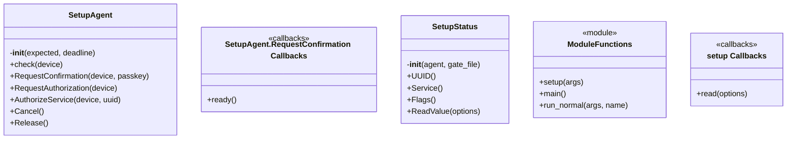

## terra_rover/backend.py

[Source](https://github.com/Super-Yojan/Terra/blob/8695cf67992647c163142cf3f3b6d81aaaba4bd0/hardware/raspberry-pi/terra_rover/backend.py) · 37 explicit function/method definitions.

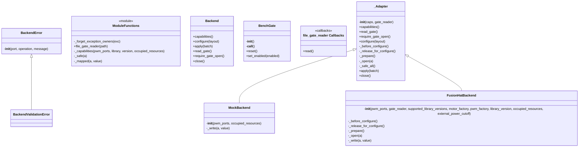

`Backend` is the interface; `_Adapter` implements common mapping and output behavior. `MockBackend` and `FusionHatBackend` supply concrete writes. Hardware-specific objects are supplied by the external Fusion HAT library.

## terra_rover/ble.py

[Source](https://github.com/Super-Yojan/Terra/blob/8695cf67992647c163142cf3f3b6d81aaaba4bd0/hardware/raspberry-pi/terra_rover/ble.py) · 27 explicit function/method definitions.

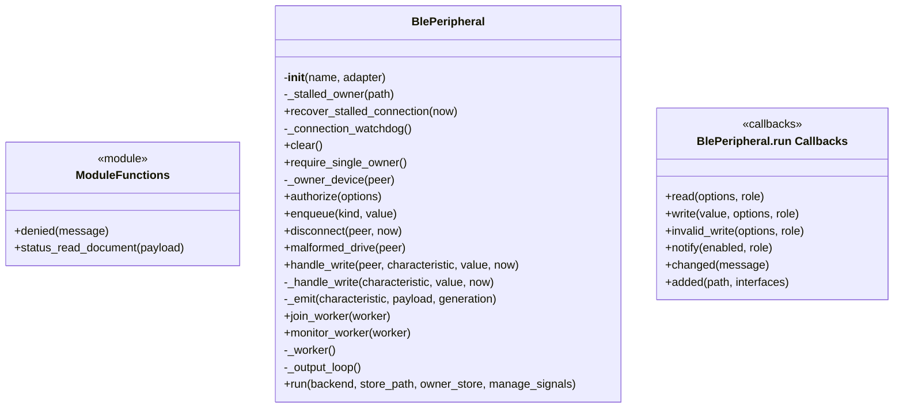

`_worker()` owns actuator output. `run()` registers GATT callbacks and lifecycle handlers; its nested functions appear in the callbacks group. `_connection_watchdog()` recovers stalled owner admission separately from the 200 ms motor-command watchdog in `safety.py`.

## terra_rover/bless_transport.py

[Source](https://github.com/Super-Yojan/Terra/blob/8695cf67992647c163142cf3f3b6d81aaaba4bd0/hardware/raspberry-pi/terra_rover/bless_transport.py) · 18 explicit function/method definitions.

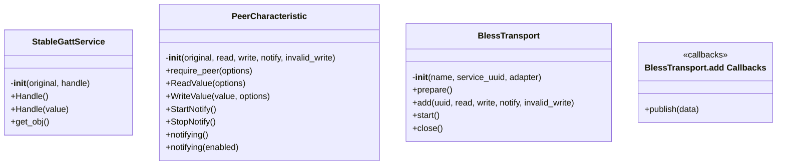

## terra_rover/configuration.py

[Source](https://github.com/Super-Yojan/Terra/blob/8695cf67992647c163142cf3f3b6d81aaaba4bd0/hardware/raspberry-pi/terra_rover/configuration.py) · 24 explicit function/method definitions.

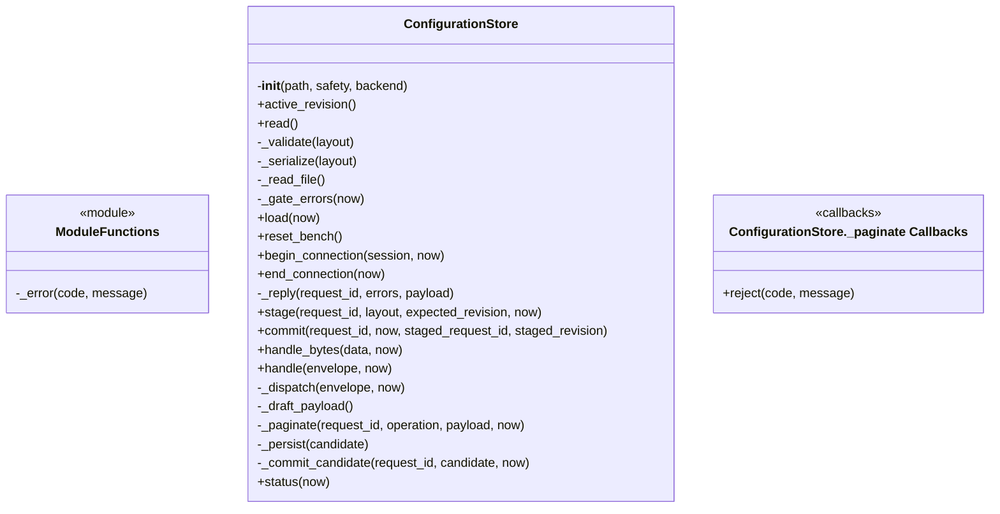

## terra_rover/layout.py

[Source](https://github.com/Super-Yojan/Terra/blob/8695cf67992647c163142cf3f3b6d81aaaba4bd0/hardware/raspberry-pi/terra_rover/layout.py) · 6 explicit function/method definitions.

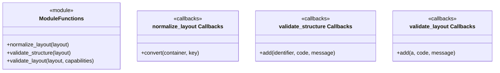

## terra_rover/lifecycle.py

[Source](https://github.com/Super-Yojan/Terra/blob/8695cf67992647c163142cf3f3b6d81aaaba4bd0/hardware/raspberry-pi/terra_rover/lifecycle.py) · 4 explicit function/method definitions.

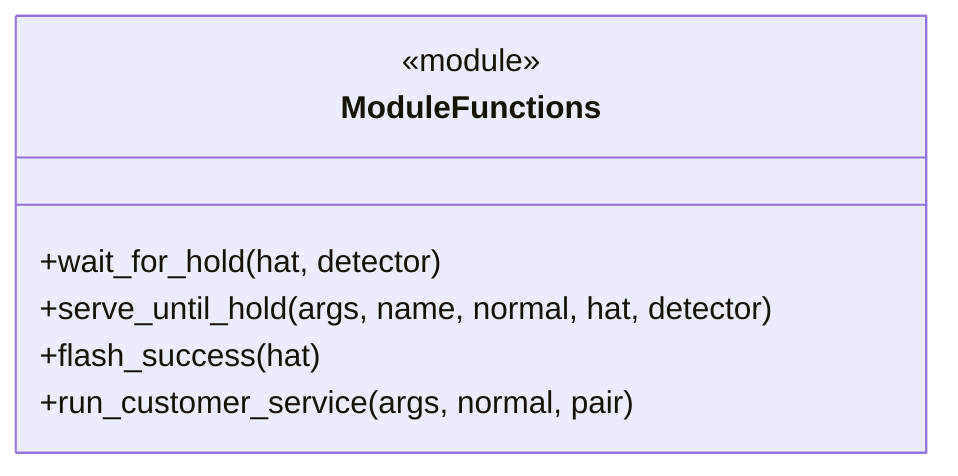

## terra_rover/log_forwarder.py

[Source](https://github.com/Super-Yojan/Terra/blob/8695cf67992647c163142cf3f3b6d81aaaba4bd0/hardware/raspberry-pi/terra_rover/log_forwarder.py) · 2 explicit function/method definitions.

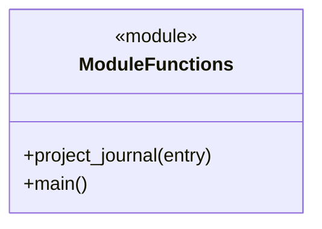

## terra_rover/observability.py

[Source](https://github.com/Super-Yojan/Terra/blob/8695cf67992647c163142cf3f3b6d81aaaba4bd0/hardware/raspberry-pi/terra_rover/observability.py) · 18 explicit function/method definitions.

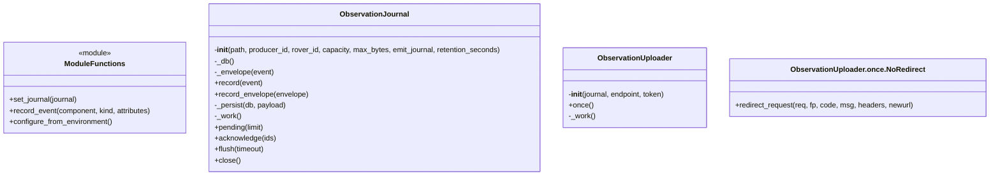

The journal and uploader run independently of actuator control. Observation failures are caught rather than used as motion-admission decisions.

## terra_rover/onboarding.py

[Source](https://github.com/Super-Yojan/Terra/blob/8695cf67992647c163142cf3f3b6d81aaaba4bd0/hardware/raspberry-pi/terra_rover/onboarding.py) · 11 explicit function/method definitions.

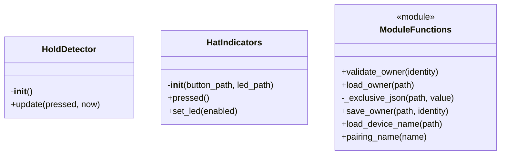

## terra_rover/pairing.py

[Source](https://github.com/Super-Yojan/Terra/blob/8695cf67992647c163142cf3f3b6d81aaaba4bd0/hardware/raspberry-pi/terra_rover/pairing.py) · 23 explicit function/method definitions.

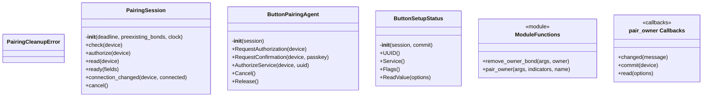

## terra_rover/protocol.py

[Source](https://github.com/Super-Yojan/Terra/blob/8695cf67992647c163142cf3f3b6d81aaaba4bd0/hardware/raspberry-pi/terra_rover/protocol.py) · 21 explicit function/method definitions.

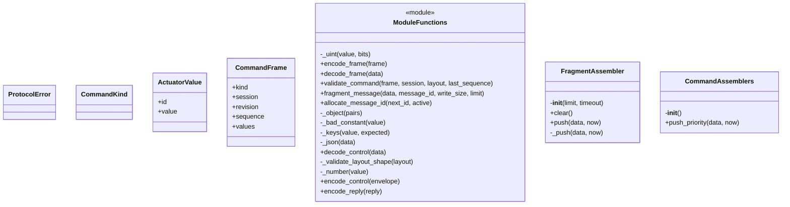

## terra_rover/safety.py

[Source](https://github.com/Super-Yojan/Terra/blob/8695cf67992647c163142cf3f3b6d81aaaba4bd0/hardware/raspberry-pi/terra_rover/safety.py) · 19 explicit function/method definitions.

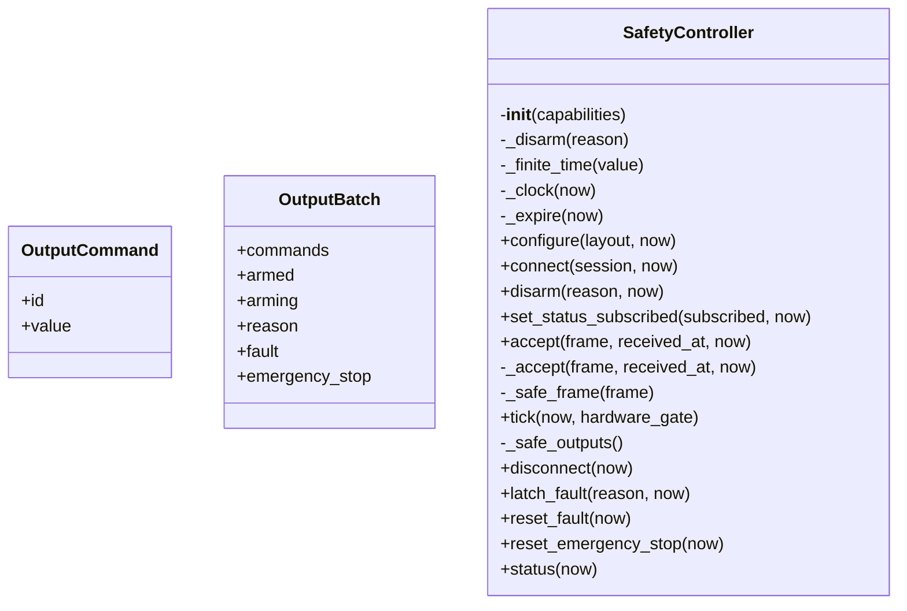

## terra_rover/usb_queue.py

[Source](https://github.com/Super-Yojan/Terra/blob/8695cf67992647c163142cf3f3b6d81aaaba4bd0/hardware/raspberry-pi/terra_rover/usb_queue.py) · 6 explicit function/method definitions.

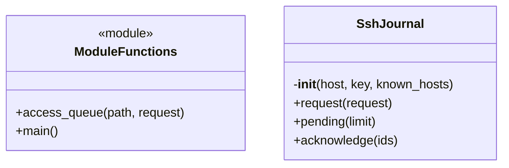
