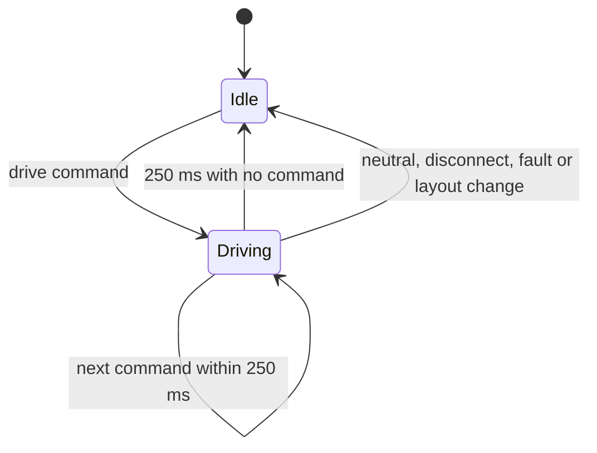

# Hardware

> [!TIP]
> **TL;DR**
> 64-bit Pi. Executable `terra-rover`. Fusion HAT.
> TerraPhone on an iPhone is the controller.
> The Rust crates do not run on the Pi.

*The Pi relays drive commands from the phone and holds each one for 250 ms.*

*Artwork from the iOS catalog, not a bench photo.*

| Guide | Use it for |
| --- | --- |
| [Flash the SD card](FLASH_SD.md) | Ready-made Terra image, Raspberry Pi Imager steps. |
| [Install](INSTALL.md) | Build, `install.sh`, USR enrollment. |
| [Bluetooth](BLUETOOTH.md) | GATT, frames, owner admission. |
| [Fusion HAT](FUSION_HAT.md) | Pins, timers, library 1.14.0. |
| [Function UML](FUNCTIONS_UML.md) | All Pi runtime functions, module dependencies, and the drive command path. |
| [Bench](BENCH.md) | Wheels-up outline. Not performed. |
| [Evidence](evidence/README.md) | What was checked, and what was not. |

Software twin of the motor checklist: [terra-motors](../crates/terra-motors.md).

*Zero effort coasts. It does not brake.*
