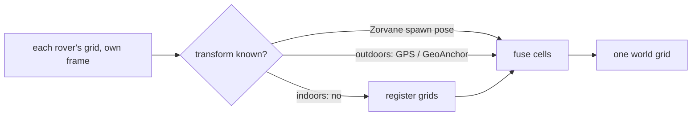
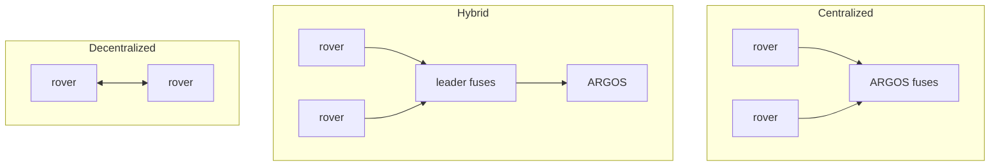

# Map fusion: crates and architectures

> [!TIP]
> **TL;DR**
> No Rust crate does multi-robot grid map merging. Build it on small crates.
> Fusing grids is easy (`terra-map-merge`). Finding the rover-to-world transform is the hard part.
> Start centralized in ARGOS. Write hybrid and decentralized up as a paper comparison.

Umbrella: Terra #95. Steps: Zorvane #8 → #13 (world frame) → #14 (grid merge). Crates surveyed on crates.io, 2026-11-09.

## The two problems

| Problem | Difficulty | Where it stands |
| --- | --- | --- |
| Fuse cells once frames line up | Easy | `terra-map-merge` (this PR) |
| Transform, Zorvane | Easy | Spawn pose (Zorvane #13) |
| Transform, outdoors | Medium | ARGOS already fits a frame per rover (`FrameAligner`, GeoAnchor). GPS is metres off. |
| Transform, indoors | Hard | Register the grids. `plot_sim_rovers.py` prototype: voting + ICP. ICP slides along straight walls. |

## Candidate crates

| Crate | Version (updated) | Role | Verdict |
| --- | --- | --- | --- |
| — (none) | — | Multi-robot map merge | **Nothing exists.** ROS `multirobot_map_merge` is C++ only. |
| `terra-map-merge` | new | Cell fusion + metrics | **Use.** Priority and log-odds rules, no deps. |
| `occupancy-map-rs` | 0.1.1 (2026-09) | Log-odds grid from depth | Ours. Builds grids, does not fuse them. |
| `opencv` | 0.102 (2026-11) | ORB + RANSAC similarity, phase correlation | **Best registration option** (same method as ROS map_merge). Native OpenCV build is heavy for ARGOS on 3 OSes. |
| `imageproc` | 0.27 (2026-06) | Template matching, edges, distance transform | **Use** for pure-Rust registration seeds and chamfer scoring. |
| `rustfft` | 6.4 (2025-09) | FFT | **Use** for phase correlation / Fourier-Mellin rotation + translation search. Pure Rust. |
| `kiddo` | 6.3 (2026-09) | k-d tree | **Use** for ICP nearest neighbours on occupied cells. |
| `nalgebra` | 0.35 (2026-05) | SVD, transforms | **Use** for the ICP / Kabsch step. |
| `arrsac` + `sample-consensus` | 0.11 (2025-08) | Robust RANSAC | Maybe, if we match features. Small user base. |
| `rigidity` | 0.2 (2026-08) | ICP that reports which DOF are constrained | **Try.** Targets our exact failure: ICP sliding along walls. Very new, 50 downloads. |
| `kornia-3d` | 0.2 (2026-09) | ICP on point clouds | Maybe. Active project, 3D focus, API still moving. |
| `rust_robotics_mapping` / `_slam` | 0.1 (2026-06) | NDT, grids, ICP | Reference code, not a dependency. Very low use. |
| `cartographer-slam` | 0.1 (2026-10) | Cartographer port | Skip. Full SLAM, brand new. |
| `kiss-icp-*`, `fast-gicp` | 2024 / 2025 | 3D LiDAR odometry | Skip. 3D scans, stale or C++ bindings. |
| `akaze`, `cv-core` (rust-cv) | 2020 | Features | Skip. Unmaintained. |
| `costmap` | 0.2 (2026-02) | Nav2-style costmaps | Skip. Navigation, not fusion. |
| `maps` | 1.12 (2026-10) | GUI to inspect and align grid maps | **Use as a tool**, not a dependency: hand-align a real run to get ground truth. |
| `automerge` | 0.12 (2026-09) | CRDT | Skip. A log-odds sum already merges in any order. |
| `rerun` | 0.42 (2026-11) | Visual debugging | Optional, for comparing fused maps run to run. |

Pick: `terra-map-merge` for fusion, then `rustfft` + `imageproc` (seed) and `kiddo` + `nalgebra` (refine) for indoor registration. Keep `opencv` as the fallback if pure Rust is not accurate enough.

## Architectures

| | Centralized | Hybrid | Decentralized |
| --- | --- | --- | --- |
| Who fuses | ARGOS | Group leader, then ARGOS | Every rover, with neighbours |
| New transport | None: rovers already publish `map/occupancy` | Leader topics + election | Peer Zenoh + map exchange |
| Phone compute | None | Leader phone fuses | Every phone fuses |
| Survives ARGOS loss | No | Groups keep local maps | Yes |
| Bandwidth to ARGOS | Every rover's grid | One grid per group | Optional |
| Fits the thesis | Yes: one operator, one dashboard | Only past ~8 rovers | Not needed for the pilot |

## Recommendation

1. **Centralized in ARGOS.** Use `terra-map-merge` from the existing per-rover grid cache.
2. ARGOS subscribes to `map/occupancy` only for focused rovers today. Fusion needs every rover's grid. Measure that bandwidth first.
3. Evaluate in Zorvane with 2–3 rovers and spawn poses, then one real run.
4. Hybrid and decentralized: paper comparison only, unless centralized fails a metric.

## Metrics

| Metric | How |
| --- | --- |
| Map agreement | `agreement(fused, ground_truth)`: accuracy, coverage, false occupied, false free |
| Bandwidth per rover | Bytes/s on `map/occupancy` per rover |
| Fusion latency | Grid received → fused grid ready |
| Dropout | Stop one rover mid-run. Its cells should stay, then age out. |
| Registration error (later) | Metres and degrees vs the spawn pose |

## Open questions

- Should a dropped rover's cells stay forever or age out?
- Which fusion rule should ARGOS show by default? Log-odds is the safer default for false obstacles.
- Indoors: is a shared ARKit world map (collaborative session) an option instead of registration?
