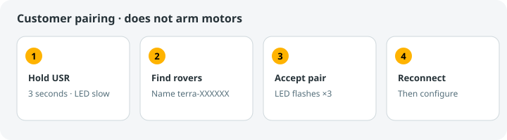
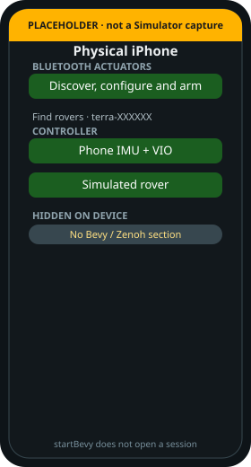
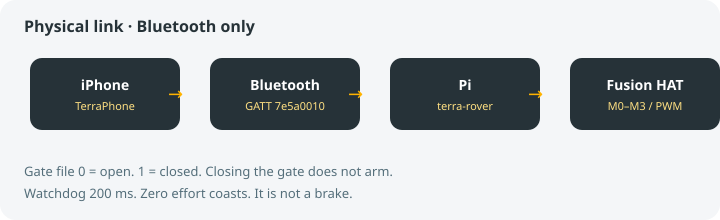

# Bluetooth pairing

> [!TIP]
> **TL;DR**
> Physical phone only. Android uses the same USR hold.
> Hold the Fusion HAT USR button for 3 seconds.
> Name looks like `terra-XXXXXX`.
> Pairing does not arm the motors.

*LED: slow blink while waiting, fast while enrolling, three flashes when saved, then solid.*

*Placeholder of the device section. Radio sessions are still unverified. See [evidence](../hardware/evidence/README.md).*

## Steps

1. Rover on. TerraPhone open.
2. Hold USR for three seconds. Window lasts 60 seconds.
3. Accept the **Connect / Not now** popup for `terra-XXXXXX` and the iOS pairing prompt if shown.
4. Three flashes confirm ownership; the app reconnects automatically.
5. Stage a layout, commit, then Arm when it is safe.

Just Works enrollment requires the physical hold. Keep it supervised. On an owned rover,
the same three-second hold stops motor outputs, disconnects the old phone, and clears
its owner record and Bluetooth bond before opening pairing. The name and layout stay
saved. If the window expires, the rover stays unowned; release USR and hold again.

*Read status before writes. Fresh drive is 20 Hz. Rover watchdog is 200 ms.*

Open **Choose rover or add rover** on Home to select a saved rover or use **Add rover**.
The phone remembers multiple confirmed pairings and reconnects to the selected rover.
Switching disconnects and disarms the current rover. Forgetting a rover removes only
that phone’s saved entry; ownership is reset using USR. Turn automatic connection off
in Settings.

Developer numeric pairing is `--setup-owner` with the customer service stopped. Full bytes: [Bluetooth peripheral](../hardware/BLUETOOTH.md).

Android TerraPhone on a physical device shows Scan, Connect, Arm, and Disarm. It hides that section on an emulator. The Android screen can stage and commit the layout it just read; the actuator editor described above is still the iOS app. Leaving the Android app disarms and disconnects. Pairing, radio timing, and a real drive have not been verified on an Android handset. See [TerraPhone for Android](../MOBILE_ANDROID.md).

Bench mode shows **Enable Bench Control** separately from Arm. It says there is no physical cutoff.

## Configuration pages

The app requires the rover capability `actuator_pagination_v1`. Connection reads a small actuator index, then one compact drive profile at a time. Opening an actuator loads only that actuator's editable configuration. The full `layout.json` remains on the rover.

Editing begins a rover draft with `begin_layout_edit`. Each `stage_actuator` or `remove_actuator` acknowledgment advances its version. `validate_layout_edit` validates the complete draft on the rover; `commit_layout_edit` applies that exact version atomically and replies with the revision. `discard_layout_edit` abandons the draft. Presets ask for missing physical ports before uploading each actuator.

Configuration messages have a 4,080-byte bound, a two-second fragment assembly deadline and a five-second acknowledgment deadline. **Retry interrupted operation** replays the exact request ID to recover the rover's cached acknowledgment. **Retry configuration** reloads the index and drive profiles after synchronization failure. Motion still uses its separate freshness limits and watchdog. Reconnect or revision changes invalidate draft authority and drive profiles; unsent editor changes remain visible.
