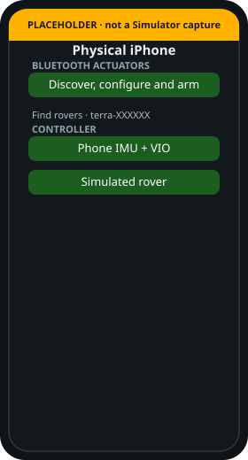

# Simulator and a physical iPhone

> [!TIP]
> **TL;DR**
> Compile-time split. Not a setting.
> Simulator: the local simulated rover.
> iPhone: Bluetooth to a real rover.

*Placeholder.*

| | Simulator | iPhone |
| --- | --- | --- |
| Bluetooth Discover | Hidden | Shown |
| Simulated rover plant | Shown | Shown |
| Phone IMU + VIO | Needs a real phone | Shown |

[Terra #25](https://github.com/Super-Yojan/Terra/issues/25) asked for this. [PR #26](https://github.com/Super-Yojan/Terra/pull/26) landed it.

The phone does not connect to the Zorvane (Bevy) simulator on either target.
